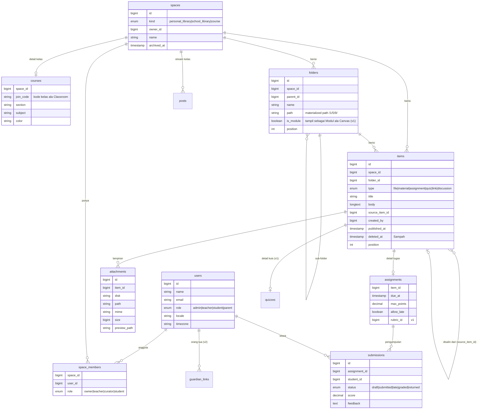

# Audit Falcon LMS

| | |
|---|---|
| **Tanggal** | 22 Oktober 2026 |
| **Commit yang diaudit** | `84bcdd4` ("first commit") |
| **Branch audit** | `claude/audit-falcon-lms-wu1e2m` |
| **Lingkup** | Kondisi kode saat ini, analisis kekurangan dibanding goal produk, rancangan arsitektur & UX, roadmap |
| **Perubahan kode** | Tidak ada. Dokumen ini hanya berisi temuan dan rekomendasi. |

### Goal produk (sesuai brief)

Falcon LMS adalah LMS dengan **tampilan dan cara kerja seperti Google Drive**. Pusatnya tombol besar
**+ Baru** yang *paham posisi halaman*:

- di **Beranda/Pustaka**, materi masuk ke **Pustaka** (tempat penyimpanan materi);
- di dalam **Kelas**, materi masuk ke kelas tersebut, termasuk ke folder yang sedang dibuka.

Isinya menggabungkan fitur terbaik **Schoology** (pustaka materi yang bisa dipakai ulang, buku nilai, akses orang tua),
**kesederhanaan Google Classroom** (tampilan dan alur kerja), dan **kedalaman Canvas LMS** (modul, SpeedGrader, rubrik, kalender).

### Keputusan yang sudah disepakati

| # | Topik | Keputusan |
|---|---|---|
| 1 | Lingkup | Audit + rancangan dulu, lalu implementasi menunggu persetujuan |
| 2 | Pustaka | Dua lapis: **Pustaka Saya** (pribadi guru) dan **Pustaka Sekolah** (bersama) |
| 3 | Peran | Admin, Guru, Siswa sejak awal. **Orang Tua** di tahap berikutnya |
| 4 | + Baru di dalam kelas | Tersimpan di kelas, dengan opsi centang **"Simpan juga ke Pustaka Saya"** |
| 5 | Bahasa | Bahasa Indonesia, disiapkan i18n supaya bisa ditambah bahasa lain |

---

## 1. Ringkasan eksekutif

1. **Fitur LMS belum ada sama sekali.** Repo masih berupa *Laravel Blank Vue Starter Kit* tanpa perubahan:
   satu halaman `Welcome.vue`, satu model `User`, migrasi bawaan, dan satu route `/`. Belum ada login, kelas,
   pustaka, materi, maupun tombol + Baru. Progres terhadap goal: **0%**.
2. **Fondasi teknisnya bagus dan modern.** Laravel 13, Inertia 3, Vue 3.5, TypeScript strict, Tailwind 4, Pest,
   PHPStan level 7, Pint, dan linter yang menolak warning. Tidak perlu ganti stack.
3. **CI di `main` merah sejak commit pertama.** Job `ci` gagal dalam 3 detik tanpa pernah mendapat runner
   (detail di [F2](#f2-ci-merah-sejak-commit-pertama-job-tidak-pernah-berjalan)). Ini harus diperbaiki sebelum fitur apa pun dibangun.
4. **Versi PHP tidak konsisten.** `composer.json` mengizinkan PHP 8.3, tapi `composer.lock` butuh PHP ≥ 8.4.1
   ([F1](#f1-versi-php-di-composerjson-tidak-sesuai-composerlock)).
5. **Kunci arsitektur untuk tombol + Baru pintar** adalah satu konsep **Ruang (Space)**: Pustaka Saya,
   Pustaka Sekolah, dan setiap Kelas adalah *Space*. Semua folder dan item berada di dalam satu Space. Setiap
   halaman tahu Space dan folder yang sedang dibuka, jadi + Baru cukup mengirim keduanya ke **satu endpoint**.
   Detail di [§3](#3-rancangan-arsitektur).

### Skor kesiapan per area

| Area | Status | Catatan |
|---|---|---|
| Stack & tooling | 🟢 Baik | Modern, tipe ketat, linter & formatter siap |
| CI/CD | 🔴 Rusak | Job tidak berjalan; Dependabot hanya untuk GitHub Actions |
| Autentikasi & peran | 🔴 Belum ada | Starter kit "blank" tidak menyertakan login |
| Model data LMS | 🔴 Belum ada | Hanya tabel `users` |
| UI/UX ala Drive | 🔴 Belum ada | Belum ada layout, komponen UI, maupun ikon |
| Penyimpanan file | 🟠 Belum siap | Disk `local` tanpa aturan akses, batas ukuran, atau preview |
| Testing | 🟠 Minim | Dua test contoh bawaan |
| Lokalisasi | 🟠 Belum diset | Locale `en`, zona waktu `UTC` |
| Keamanan dasar | 🟢 Cukup | Password kuat & proteksi perintah destruktif di production sudah aktif |

---

## 2. Kondisi saat ini

### 2.1 Stack

| Lapisan | Teknologi | Versi (lock) |
|---|---|---|
| Backend | Laravel | 13.x |
| Bahasa backend | PHP | ≥ 8.4.1 (efektif, lihat F1) |
| Jembatan SPA | Inertia.js (server + Vue adapter) | 3.x |
| Frontend | Vue 3 + TypeScript (strict) | Vue 3.5 |
| Styling | Tailwind CSS | 4.x |
| Build, lint, format | Vite 8 lewat `vite-plus` | 0.3.0 |
| Route bertipe | Laravel Wayfinder | 0.1.x |
| Test | Pest | 5.x |
| Analisis statis | PHPStan/Larastan level 7, `vue-tsc` | — |
| Database default | SQLite | — |
| Queue, cache, session | Driver `database` | — |

### 2.2 Inventaris kode

| Bagian | Isi |
|---|---|
| `app/` | `User` model, `AppServiceProvider`, `HandleInertiaRequests`, base `Controller` |
| `routes/web.php` | 1 route: `GET /` → `Welcome` |
| `database/migrations/` | 3 migrasi bawaan (users/sessions, cache, jobs) |
| `resources/js/pages/` | `Welcome.vue` (halaman sambutan Laravel) |
| `resources/js/components/` | Belum ada |
| `tests/` | 1 Feature test (`GET /` = 200), 1 Unit test contoh |

### 2.3 Hasil pengecekan otomatis

| Pengecekan | Hasil | Keterangan |
|---|---|---|
| `npm ci` | ✅ Lulus | |
| `npm run check` (format + lint) | ✅ Lulus | 14 file rapi, 0 warning |
| `npm run types:check` (`vue-tsc`) | ✅ Lulus | Tapi lihat F5: sebagian tipe tidak benar-benar dicek |
| `npm run build` | ⚠️ Butuh `vendor/` | Plugin Wayfinder menjalankan `php artisan wayfinder:generate`, jadi build gagal sebelum `composer install`. Wajar, tapi belum didokumentasikan |
| `composer install` di PHP 8.3 | ❌ Gagal | `symfony/*` 8.1 butuh PHP ≥ 8.4.1 (F1) |
| Pint, PHPStan, Pest | ⏸️ Tidak bisa dijalankan di lingkungan audit | PHP lokal 8.3 dan sebagian unduhan paket dari GitHub gagal. Perlu dicek ulang setelah CI pulih |
| GitHub Actions `tests` di `main` | ❌ Gagal | Run [#1](https://github.com/alaihsan/falconlms/actions/runs/39601158566) dan PR Dependabot #1 gagal dengan pola yang sama (F2) |

### 2.4 Hal yang sudah baik

- `DB::prohibitDestructiveCommands()` aktif di production, jadi `migrate:fresh` dan sejenisnya tidak bisa
  jalan tanpa sengaja (`app/Providers/AppServiceProvider.php`).
- Aturan password kuat di production: minimal 12 karakter, huruf besar-kecil, angka, simbol, dan cek kebocoran.
- `CarbonImmutable` sebagai default tanggal, sehingga lebih aman dari bug mutasi tanggal.
- Workflow CI mengunci action ke SHA, memakai `persist-credentials: false`, dan `permissions: contents: read`.
- TypeScript `strict`, PHPStan level 7, linter `denyWarnings` + `typeAware`.
- Endpoint health check `/up` sudah tersedia untuk monitoring.
- Wayfinder memberi route bertipe di frontend, cocok untuk banyak endpoint + Baru nanti.

### 2.5 Temuan

Tingkat: **Tinggi** = menghambat pengembangan atau berisiko nyata · **Sedang** = perlu dibereskan di fase fondasi ·
**Rendah** = perapian.

#### F1. Versi PHP di `composer.json` tidak sesuai `composer.lock`
**Tinggi.** `composer.json:12` menulis `"php": "^8.3"`, tapi paket yang terkunci (`symfony/*` v8.1, `phpunit/phpunit` 13,
`pestphp/pest` 5) butuh PHP ≥ 8.4.1. Developer dengan PHP 8.3 akan gagal di `composer install` dengan pesan yang
membingungkan, padahal `composer.json` bilang 8.3 didukung.
**Perbaikan:** ubah ke `"php": "^8.4"`, dan samakan versi di CI (sudah 8.4), Sail/Docker, serta server production.

#### F2. CI merah sejak commit pertama: job tidak pernah berjalan
**Tinggi.** Job `ci` di run `tests` #1 (`main`) selesai dalam 3 detik dengan `runner_id: 0`, tanpa langkah dan tanpa log.
Pola yang sama terjadi di run PR Dependabot #1. Artinya **job tidak pernah mendapat runner**, jadi bukan kode yang gagal.
Penyebab umum pola ini: batas biaya/menit GitHub Actions di akun, Actions dibatasi di pengaturan repo, atau
action yang direferensikan tidak bisa di-resolve.
**Perbaikan:** buka tab *Annotations* di halaman run untuk melihat alasan resminya, lalu cek
*Settings → Actions → General* dan *Settings → Billing* di akun GitHub. Setelah runner jalan, CI akan menjalankan
lint, tipe, Pint, PHPStan, dan Pest.

#### F3. Belum ada autentikasi dan peran
**Tinggi.** Starter kit *blank* tidak menyertakan login, registrasi, reset password, atau verifikasi email.
LMS butuh semua itu, ditambah peran (Admin, Guru, Siswa, lalu Orang Tua).
**Perbaikan:** pasang **Laravel Fortify** (headless) dengan halaman Inertia/Vue, atau ambil scaffolding auth dari
*Laravel Vue Starter Kit* versi non-blank. Peran disimpan sebagai enum di `users.role`, dan otorisasi memakai **Policy** Laravel.
Untuk sekolah yang memakai Google Workspace for Education, tambahkan **Masuk dengan Google** (Laravel Socialite) di v1.

#### F4. Penyimpanan file belum siap untuk LMS
**Tinggi.** `FILESYSTEM_DISK=local` (`.env.example:37`). Belum ada aturan siapa boleh mengunduh, batas ukuran,
whitelist tipe file, preview, maupun kuota. Untuk aplikasi ala Drive, ini inti produk.
**Perbaikan:** simpan semua upload di disk **privat**, sajikan lewat controller yang mengecek Policy lalu memberi
**signed temporary URL**. Pakai penyimpanan S3-compatible (S3, R2, atau MinIO) di production. Proses thumbnail
dan preview lewat queue. Atur `upload_max_filesize`/`post_max_size` PHP dan batas di validasi.

#### F5. Tipe shared props tidak sesuai data dari server
**Sedang.**
- `resources/js/types/auth.ts:13` menulis `user: User` (tidak boleh null), padahal server mengirim `$request->user()`
  yang bernilai `null` untuk tamu. Komponen bisa crash saat mengakses `auth.user.name` di halaman publik.
- `resources/js/types/global.d.ts:22` mendeklarasikan `sidebarOpen`, tapi server tidak pernah mengirimnya.
- `global.d.ts:34-36` memakai `Router`, `Page`, dan `createHeadManager` tanpa import. Ini tidak ketahuan karena
  `skipLibCheck: true` (`tsconfig.json:119`) membuat file `.d.ts` tidak dicek, sehingga tipenya diam-diam menjadi `any`.

**Perbaikan:** ubah ke `user: User | null`, kirim `sidebarOpen` dari server (atau hapus deklarasinya), dan
import tipe yang dipakai dari `@inertiajs/core`.

#### F6. Seluruh model `User` dikirim ke setiap halaman
**Sedang.** `HandleInertiaRequests.php:42` membagikan objek `User` utuh. Saat ini aman karena `password` dan
`remember_token` disembunyikan. Tapi nanti `users` akan punya kolom seperti peran, NIS/NISN, telepon, dan relasi orang tua.
Semua kolom baru otomatis ikut terkirim ke browser.
**Perbaikan:** kirim field secara eksplisit, misalnya `['id', 'name', 'email', 'role', 'avatar_url']`, atau
lewat `JsonResource`.

#### F7. Identitas, bahasa, dan zona waktu masih bawaan Laravel
**Sedang.**
- `APP_NAME=Laravel` (`.env.example:1`) dan nama paket `laravel/blank-vue-starter-kit` (`composer.json:3`).
- `config/app.php:68` memakai `'timezone' => 'UTC'`. Tenggat tugas bisa bergeser 7 jam untuk sekolah di WIB.
- `APP_LOCALE=en` dan `APP_FAKER_LOCALE=en_US`.

**Perbaikan:** `APP_NAME="Falcon LMS"`, `timezone` dari env dengan default `Asia/Jakarta`, `APP_LOCALE=id`,
`APP_FAKER_LOCALE=id_ID`, dan pasang file terjemahan `lang/id`. Simpan waktu di database dalam UTC, tapi tampilkan
sesuai zona waktu sekolah atau pengguna.

#### F8. Dua package manager JavaScript sekaligus
**Sedang.** Ada `package-lock.json` (npm) dan `pnpm-workspace.yaml` (pnpm). Script memakai npm, dan
`composer setup` menjalankan `npm install` (`composer.json:49`), bukan `npm ci`. Akibatnya build di CI bisa memakai
versi paket yang berbeda dari lockfile.
**Perbaikan:** pilih satu (npm sudah dipakai di semua script), hapus `pnpm-workspace.yaml`, dan pakai `npm ci` di CI.

#### F9. Dependabot hanya memantau GitHub Actions
**Sedang.** `.github/dependabot.yml` tidak memantau `composer` dan `npm`, padahal kerentanan paling sering datang dari situ.
**Perbaikan:** tambahkan ekosistem `composer` dan `npm` dengan `cooldown` dan pengelompokan yang sama.

#### F10. Test hampir tidak ada
**Sedang.** Hanya dua test contoh. `tests/Pest.php:32` dan `tests/Pest.php:47` masih berisi contoh `toBeOne` dan
`something()`.
**Perbaikan:** hapus contoh-contoh itu. Wajibkan Feature test untuk setiap aturan bisnis penting, terutama
**aturan tujuan simpan + Baru** dan **Policy akses** (siswa tidak boleh melihat kelas lain, dan seterusnya).

#### F11. Belum ada README
**Rendah.** Belum ada dokumentasi cara setup. Ada beberapa jebakan yang perlu ditulis: PHP 8.4, `composer install`
harus jalan sebelum `npm run build` karena Wayfinder, dan `composer dev` untuk development.

#### F12. Font eksternal di halaman sambutan
**Rendah.** `Welcome.vue:7-8` memuat font Inter dari `rsms.me`, padahal aplikasi memakai Instrument Sans lewat
Bunny Fonts (`vite.config.ts:15`). Permintaan ke pihak ketiga ini tidak perlu. Halaman ini akan diganti, jadi
cukup dihapus saat membuat Beranda.

#### F13. Kode dark mode yang tidak terpakai
**Rendah.** `resources/views/app.blade.php:2` membaca `$appearance`, tapi tidak ada yang mengisinya.
**Perbaikan:** implementasikan pilihan tema (terang/gelap/sistem) lewat cookie, atau hapus dulu.

#### F14. Toolchain `vite-plus` masih pra-1.0
**Rendah.** `vite-plus` 0.3.0 (`package.json:30`) menangani build, lint, dan format sekaligus. Versinya sudah dikunci
persis (bagus), tapi API pra-1.0 bisa berubah. Pantau changelog-nya saat Dependabot npm sudah aktif.

#### F15. Panduan agen AI tidak ikut di-commit
**Rendah.** `.gitignore:39-41` mengabaikan `AGENTS.md`, `CLAUDE.md`, dan `boost.json`. Kalau tim memakai asisten AI
(ada `.codex/config.toml` dengan Laravel Boost), konvensi proyek tidak tersimpan di repo. Pertimbangkan untuk
meng-commit satu file panduan proyek.

---

## 3. Rancangan arsitektur

### 3.1 Konsep inti: Space → Folder → Item

Supaya + Baru selalu tahu ke mana harus menyimpan, **setiap halaman konten berada di dalam tepat satu Space**:

| Space (`spaces.kind`) | Pemilik | Contoh halaman |
|---|---|---|
| `personal_library` | Satu guru (dibuat otomatis saat akun guru dibuat) | Beranda, Pustaka Saya › folder apa pun |
| `school_library` | Sekolah (dikelola admin/kurator) | Pustaka Sekolah › folder apa pun |
| `course` | Kelas (guru pengampu) | Kelas X IPA 1 › Materi › folder apa pun |

Di dalam Space ada **Folder** (bertingkat) dan **Item**. Item punya tipe: `file`, `material` (halaman teks kaya),
`assignment`, `quiz`, `link`, dan `discussion`. Model ini sama dengan Drive (Space ≈ "Drive Saya" / "Drive Bersama",
Folder ≈ folder, Item ≈ file). Dengan begitu, Pustaka dan Kelas memakai **satu komponen tampilan yang sama**.

### 3.2 Model data (usulan)



Catatan desain:

- **Folder bertingkat** memakai `parent_id` dan kolom `path` (misalnya `/1/5/9/`). Breadcrumb, pindah folder,
  dan "isi semua sub-folder" cukup dengan satu query `LIKE '/1/5/%'`, tanpa rekursi.
- **Modul ala Canvas** tidak menjadi konsep baru. Modul adalah folder dengan `is_module = true`, ditambah urutan dan
  syarat selesai. Model mental pengguna tetap "folder", sesuai prinsip kesederhanaan.
- **Sampah ala Drive** cukup dengan *soft delete* (`deleted_at`) dan pembersihan otomatis setelah 30 hari.
- **Satu sekolah dulu.** Multi-sekolah (tenant) bisa ditambah nanti dengan kolom `school_id` di `spaces` dan `users`.

### 3.3 Logika tombol + Baru

**Prinsip:** frontend tidak menebak. Setiap controller halaman mengirim prop `context`, dan + Baru hanya membacanya.

```php
// Contoh prop yang dikirim setiap halaman konten
'context' => [
    'space'  => ['id' => 12, 'kind' => 'course', 'name' => 'X IPA 1'],
    'folder' => ['id' => 40, 'name' => 'Bab 3 - Trigonometri'],   // null = root Space
    'allowed' => ['folder', 'upload', 'material', 'assignment', 'quiz', 'link', 'discussion', 'from_library'],
    'can_also_save_to_library' => true,
],
```

```php
// routes/web.php (sketsa)
Route::get('/', HomeController::class)->name('home');                        // context: Pustaka Saya (root)
Route::get('/pustaka/{folder?}', PersonalLibraryController::class);          // context: Pustaka Saya + folder
Route::get('/pustaka-sekolah/{folder?}', SchoolLibraryController::class);
Route::get('/kelas/{course}/materi/{folder?}', CourseMaterialController::class)->scopeBindings();

// Satu endpoint untuk semua aksi "+ Baru"
Route::post('/spaces/{space}/items', StoreItemController::class)->name('items.store');
Route::post('/spaces/{space}/folders', StoreFolderController::class)->name('folders.store');
Route::post('/spaces/{space}/import', ImportFromLibraryController::class);  // "Dari Pustaka..."
```

Alur di server untuk `POST /spaces/{space}/items`:

1. **Policy** `SpacePolicy::create` mengecek pengguna boleh menambah konten di Space ini. Siswa ditolak, guru hanya di kelasnya.
   ID Space dari browser **tidak pernah dipercaya** tanpa cek ini.
2. **FormRequest** memastikan `folder_id` (jika ada) benar-benar milik `space` tersebut.
3. Item dibuat. Jika `also_save_to_library = true` (dari dalam kelas), buat juga salinan di Pustaka Saya, lalu hubungkan
   keduanya lewat `source_item_id`.
4. Redirect kembali ke halaman yang sama dan tampilkan toast "Tersimpan di *X IPA 1 › Bab 3*".
   Pengguna selalu diberi tahu **di mana** materinya tersimpan.

Unggah dengan **drag & drop ke area mana pun** di halaman memakai endpoint yang sama, dengan `context` yang sama.

### 3.4 Pustaka → Kelas: salin, bukan tautan

Saat guru memilih **"Dari Pustaka…"** di kelas (ala Schoology *Import from Resources*), item **disalin** ke kelas
dan `source_item_id` menunjuk ke aslinya. Alasannya:

- Mengedit materi kelas A tidak diam-diam mengubah kelas B atau Pustaka.
- Tugas di kelas punya data pengumpulan sendiri yang tidak boleh tercampur.
- Tautan ke asal tetap tersimpan, jadi nanti (v2) bisa ada tombol **"Perbarui dari Pustaka"**.

### 3.5 Peran dan hak akses

| Aksi | Admin | Guru | Siswa | Orang Tua (v2) |
|---|---|---|---|---|
| Kelola pengguna, impor CSV | ✅ | — | — | — |
| Pustaka Saya | — | ✅ miliknya | — | — |
| Pustaka Sekolah: lihat & salin ke kelas | ✅ | ✅ | — | — |
| Pustaka Sekolah: tambah/ubah | ✅ | Jika kurator | — | — |
| Buat kelas | ✅ | ✅ | — | — |
| + Baru di kelas | ✅ | Guru kelas itu | — | — |
| Lihat materi kelas | ✅ | Guru kelas itu | Anggota kelas itu (yang sudah terbit) | — |
| Kumpulkan tugas | — | — | ✅ | — |
| Nilai tugas | — | Guru kelas itu | — | — |
| Lihat nilai & tugas anak | — | — | Milik sendiri | Anak yang ditautkan |

Implementasinya memakai Policy Laravel (`SpacePolicy`, `ItemPolicy`, `SubmissionPolicy`). Untuk MVP tidak perlu paket
permission tambahan.

### 3.6 Rekomendasi pustaka teknis

| Kebutuhan | Rekomendasi | Alasan |
|---|---|---|
| Auth | Laravel Fortify (+ Socialite untuk Google di v1) | Resmi, headless, cocok untuk Inertia |
| Komponen UI | shadcn-vue (Reka UI) + ikon `lucide-vue-next` | Sejalan dengan starter kit resmi. Konfigurasi lint sudah mengecualikan `resources/js/components/ui/*` |
| Editor materi | Tiptap (Vue 3) | Editor teks kaya yang ringan dan bisa diperluas |
| Unggah file besar | Upload bertahap (chunked) atau presigned URL langsung ke S3 | Video pembelajaran sering ratusan MB |
| Preview | Gambar & video native, PDF lewat pdf.js, dokumen Office dikonversi ke PDF di queue (v1) | Guru dan siswa tidak perlu mengunduh untuk melihat |
| Pencarian | Laravel Scout (driver database) → Meilisearch di v1 | Mulai sederhana, bisa ditingkatkan |
| Notifikasi real-time | Laravel Notifications, lalu Laravel Reverb di v1 | Resmi, bisa di-host sendiri |

---

## 4. Rancangan UX

### 4.1 Tata letak

```
+-----------------------------------------------------------------------------+
| [F] Falcon LMS      [ Cari materi, kelas, tugas...               ]  (!) (A) |
+------------------+----------------------------------------------------------+
|  +-------------+ | Kelas X IPA 1 > Materi > Bab 3 - Trigonometri            |
|  |  +  Baru    | | [Stream] [Materi] [Anggota] [Nilai]     [Grid | List]    |
|  +-------------+ |                                                          |
|                  | Folder                                                   |
|  Beranda         | +------------+ +------------+ +------------+             |
|  Pustaka Saya    | | Video      | | LKS        | | Latihan    |             |
|  Pustaka Sekolah | +------------+ +------------+ +------------+             |
|                  |                                                          |
|  KELAS           | Item                                                     |
|  > X IPA 1       | +------------+ +------------+ +------------+             |
|  > XI IPS 2      | | PDF        | | TUGAS      | | TAUTAN     |             |
|                  | | Rumus.pdf  | | Latihan 3  | | GeoGebra   |             |
|  To-do           | |            | | s.d. 25 Okt| |            |             |
|  Kalender        | +------------+ +------------+ +------------+             |
|  Sampah          |                                                          |
|                  |       (seret file ke sini untuk mengunggah)              |
+------------------+----------------------------------------------------------+
```

- **Sidebar kiri** seperti Drive: + Baru paling atas, lalu Beranda, Pustaka, daftar kelas, To-do, Kalender, Sampah.
- **Breadcrumb** selalu menunjukkan posisi. Ini sekaligus menjadi "label" ke mana + Baru akan menyimpan.
- **Tab kelas** mengikuti Classroom yang sudah dikenal guru: Stream, Materi (tampilan Drive), Anggota, Nilai.
- **Grid atau list** bisa diganti, dan pilihannya diingat per pengguna.

### 4.2 Isi + Baru sesuai posisi halaman

| Posisi halaman | Tujuan simpan | Isi menu |
|---|---|---|
| **Beranda** | Pustaka Saya (root) | Folder · Unggah file · Unggah folder · Materi · Tugas* · Kuis* · Tautan |
| **Pustaka Saya › folder** | Folder itu | Sama seperti di atas |
| **Pustaka Sekolah › folder** | Folder itu (jika kurator) | Sama. Jika bukan kurator, tombol nonaktif dengan keterangan |
| **Kelas › Stream** | Stream kelas | Pengumuman · Materi · Tugas · Kuis · Pertanyaan · Dari Pustaka… |
| **Kelas › Materi › folder** | Folder kelas itu | Folder · Unggah · Materi · Tugas · Kuis · Tautan · Diskusi · Dari Pustaka… + ☐ *Simpan juga ke Pustaka Saya* |
| **Kelas › Anggota** | — | + Baru berubah menjadi **Undang siswa / Undang guru / Tampilkan kode kelas** |
| **Kelas › Nilai** (v1) | — | Kolom nilai manual · Kategori nilai |
| **Kalender** (v1) | Kelas yang dipilih di dialog | Tugas · Acara |
| **To-do, Sampah** | Pustaka Saya (root) | Sama seperti Beranda |

\* *Tugas dan Kuis di Pustaka berfungsi sebagai **templat**. Siswa baru bisa mengerjakan setelah templat disalin ke kelas.*

**Siswa:** + Baru disembunyikan di MVP. Di halaman tugas, siswa mendapat tombol **"+ Tambah atau buat"** untuk
melampirkan jawaban (ala Classroom).

### 4.3 Prinsip kesederhanaan (pagar terhadap fitur yang menumpuk)

Menggabungkan tiga LMS berisiko membuat aplikasi rumit. Setiap fitur baru harus lolos aturan ini:

1. **Jalur utama maksimal 3 klik.** Membuat tugas: + Baru → Tugas → isi → Tetapkan.
2. **Pengaturan lanjutan disembunyikan** di bagian "Opsi lainnya" (rubrik, jadwal terbit, prasyarat modul).
3. **Satu pola tampilan.** Pustaka, Kelas, dan Modul memakai komponen Drive yang sama.
4. **Selalu beri tahu lokasi simpan** lewat toast dan breadcrumb.
5. **Fitur kuat lewat pintasan, bukan menu tambahan:** klik kanan, multi-pilih, seret untuk memindah, pintasan keyboard.

---

## 5. Analisis kekurangan: matriks fitur

Semua fitur di bawah **belum ada** saat ini. Kolom *Fase* menunjukkan usulan prioritas.

| Fitur | Inspirasi | Fase |
|---|---|---|
| Login, reset password, peran | Semua | 0 |
| Layout Drive: sidebar, + Baru, breadcrumb, grid/list | Google Drive | 0–1 |
| + Baru sesuai posisi halaman | Brief Falcon | 1 |
| Pustaka Saya: folder, unggah, materi, tautan | Schoology Resources | 1 |
| Preview file di browser | Google Drive | 1 |
| Buat kelas, gabung dengan kode kelas | Google Classroom | 1 |
| Tab Stream, Materi, Anggota | Google Classroom | 1 |
| Salin dari Pustaka ke kelas; "Simpan juga ke Pustaka" | Schoology | 1 |
| Tugas: tenggat, poin, kumpul, nilai, komentar | Classroom / Canvas | 1 |
| To-do siswa (tugas mendatang & terlambat) | Canvas / Classroom | 1 |
| Notifikasi di aplikasi | Semua | 1 |
| Admin: kelola pengguna & impor CSV | Schoology / Canvas | 1 |
| Kuis dengan penilaian otomatis | Schoology / Canvas | 2 |
| Rubrik | Canvas | 2 |
| Tampilan penilaian cepat (ala SpeedGrader) | Canvas | 2 |
| Buku nilai dengan kategori berbobot | Schoology / Canvas | 2 |
| Modul dengan prasyarat & syarat selesai | Canvas | 2 |
| Jadwal terbit materi | Google Classroom | 2 |
| Kalender | Canvas / Schoology | 2 |
| Diskusi berutas | Canvas / Schoology | 2 |
| Pustaka Sekolah & peran kurator | Schoology Group Resources | 2 |
| Sampah & pulihkan | Google Drive | 2 |
| Seret untuk memindah, multi-pilih, klik kanan, pintasan keyboard | Google Drive | 2 |
| Komentar privat di tugas | Google Classroom | 2 |
| Pencarian global | Google Drive | 2 |
| Notifikasi email & ringkasan harian | Semua | 2 |
| Masuk dengan Google (SSO) | Google Classroom | 2 |
| Akses Orang Tua | Schoology | 3 |
| Bank soal | Schoology | 3 |
| Capaian pembelajaran / mastery | Schoology / Canvas | 3 |
| Analitik keterlibatan siswa | Schoology | 3 |
| Peer review | Canvas | 3 |
| Integrasi LTI 1.3 & pemilih Google Drive | Canvas | 3 |
| Riwayat versi & "Perbarui dari Pustaka" | Google Drive | 3 |
| Ekspor nilai (Excel) & rapor | Lokal Indonesia | 3 |
| PWA / mode hemat data | — | 3 |
| Multi-sekolah | — | 3 |

---

## 6. Roadmap

Setiap fase ditutup dengan CI hijau dan Feature test untuk semua aturan baru.

### Fase 0: Fondasi & perapian

- Perbaiki F1 (versi PHP), F2 (CI), F5 (tipe), F6 (shared props), F7 (identitas, bahasa, zona waktu), F8 (npm saja),
  F9 (Dependabot), F10 (hapus contoh test), F11 (README).
- Pasang Fortify: login, logout, lupa password. Kolom `users.role`. Seeder akun demo admin, guru, dan siswa.
- Pasang shadcn-vue dan lucide. Buat `AppLayout`: sidebar, topbar, kerangka tombol + Baru, breadcrumb.
- Siapkan disk privat dan controller unduhan dengan signed URL.

**Selesai jika:** pengguna bisa login sesuai peran dan melihat layout Drive kosong, dan CI hijau di PHP 8.4.

### Fase 1: MVP "Drive + Kelas"

- Migrasi, model, dan Policy untuk `spaces`, `space_members`, `courses`, `folders`, `items`, `attachments`,
  `assignments`, `submissions`, `posts`.
- Pustaka Saya: tampilan Drive, CRUD folder, unggah, materi (Tiptap), tautan, preview.
- **+ Baru sesuai posisi halaman** lewat satu endpoint, termasuk unggah dengan drag & drop.
- Kelas: buat, kode kelas, anggota, tab Stream/Materi/Anggota.
- "Dari Pustaka…" dan "Simpan juga ke Pustaka Saya".
- Tugas: buat, kumpulkan, nilai, komentar. To-do siswa. Notifikasi di aplikasi.
- Admin: kelola pengguna dan impor CSV.

**Selesai jika:** seorang guru bisa (1) mengunggah materi di Beranda dan menemukannya di Pustaka Saya,
(2) membuat kelas, (3) menyalin materi dari Pustaka ke kelas, dan (4) membuat tugas. Seorang siswa bisa
bergabung dengan kode kelas, mengumpulkan tugas, dan melihat nilainya. Semua aturan tujuan simpan
**+ Baru tercakup Feature test.**

### Fase 2: v1 "Classroom + Canvas"

Kuis, rubrik, tampilan penilaian cepat, buku nilai, modul, jadwal terbit, kalender, diskusi, Pustaka Sekolah,
Sampah, interaksi lanjutan ala Drive, pencarian global, email, dan SSO Google.

### Fase 3: v2 "Schoology lanjutan"

Akses orang tua, bank soal, mastery, analitik, peer review, LTI, riwayat versi, ekspor rapor, PWA, multi-sekolah.

---

## 7. Risiko dan keputusan yang masih terbuka

### Risiko

| Risiko | Mitigasi |
|---|---|
| Biaya penyimpanan & bandwidth video | Penyimpanan S3-compatible, batas ukuran per file, kuota per guru, sarankan tautan YouTube untuk video panjang |
| Fitur menumpuk sampai tidak sederhana lagi | Terapkan prinsip §4.3 di setiap review desain |
| Data pribadi siswa (UU No. 27/2022 tentang Pelindungan Data Pribadi) | Minimalkan data yang dikumpulkan, Policy akses ketat, log akses, kebijakan retensi data, persetujuan orang tua untuk siswa di bawah umur |
| Toolchain pra-1.0 (`vite-plus`) | Kunci versi persis dan aktifkan Dependabot npm |
| Struktur folder dalam yang lambat | Kolom `path` dan index; uji dengan data ribuan item |

### Keputusan yang masih perlu dijawab

1. **Satu sekolah atau banyak sekolah?** Rancangan ini mengasumsikan satu sekolah dulu.
2. **Apakah siswa punya "Drive Saya" sendiri** (misalnya untuk portofolio)? Asumsi: belum di MVP.
3. **Target hosting** (VPS, shared hosting, cloud)? Ini menentukan apakah queue worker, Reverb, dan
   konversi dokumen (LibreOffice) bisa dipakai.
4. **Apakah sekolah sasaran memakai Google Workspace for Education?** Jika ya, SSO Google dan pemilih
   Google Drive layak dinaikkan prioritasnya.

---

## Lampiran: cara mengulang pengecekan

```bash
# Butuh PHP >= 8.4 dan Node 22
composer install
cp .env.example .env && php artisan key:generate
php artisan migrate
npm ci

npm run check          # format + lint frontend
npm run types:check    # vue-tsc
composer test          # Pint + PHPStan + Pest
npm run build          # butuh vendor/ (Wayfinder)
```
