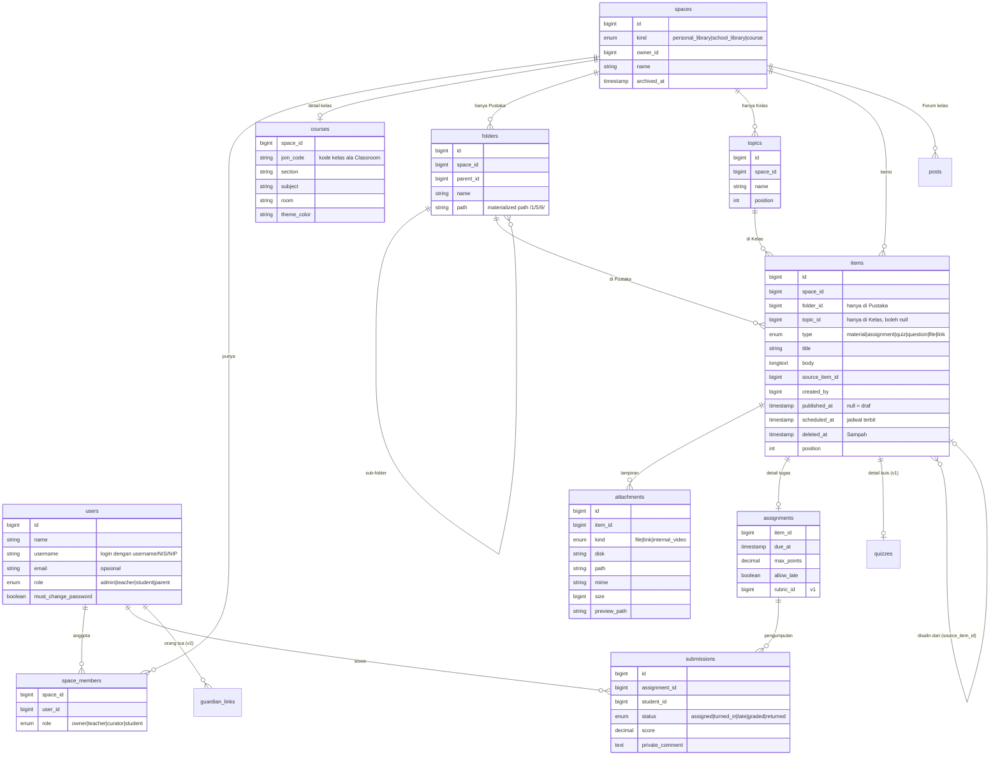

# Audit Falcon LMS

|                         |                                                                                                      |
| ----------------------- | ---------------------------------------------------------------------------------------------------- |
| **Tanggal**             | 23 Oktober 2026 (revisi 5)                                                                           |
| **Commit yang diaudit** | `84bcdd4` ("first commit")                                                                           |
| **Branch audit**        | `claude/audit-falcon-lms-wu1e2m`                                                                     |
| **Lingkup**             | Kondisi kode saat ini, analisis kekurangan dibanding goal produk, rancangan arsitektur & UX, roadmap |
| **Perubahan kode**      | Audit tidak mengubah kode. Fase 0 dan Fase 1 sudah diimplementasikan (lihat [§6](#6-roadmap)).       |

### Goal produk (sesuai brief)

Falcon LMS adalah LMS **khusus intranet sekolah** dengan **tampilan dan cara kerja seperti Google Drive**.
Pusatnya tombol besar **+ Baru** yang _paham posisi halaman_:

- di **Beranda/Pustaka**, materi masuk ke **Pustaka** (tempat penyimpanan materi, memakai folder ala Drive);
- di dalam **Kelas**, materi masuk ke kelas tersebut, ke **topik** yang sedang dibuka.

Isi kelas diatur **persis seperti Google Classroom**: tidak ada folder bertingkat, semua materi dan tugas
dikelompokkan dengan **Topik**. Fitur lainnya mengambil yang terbaik dari **Schoology** (pustaka materi yang bisa
dipakai ulang, buku nilai, akses orang tua) dan **Canvas LMS** (SpeedGrader, rubrik, kalender), tanpa mengorbankan
kesederhanaan Classroom.

### Keputusan yang sudah disepakati

| #   | Topik                 | Keputusan                                                                                                                                                                             |
| --- | --------------------- | ------------------------------------------------------------------------------------------------------------------------------------------------------------------------------------- |
| 1   | Lingkup               | Audit + rancangan dulu, lalu implementasi menunggu persetujuan                                                                                                                        |
| 2   | Pustaka               | Dua lapis: **Pustaka Saya** (pribadi guru) dan **Pustaka Sekolah** (bersama). Keduanya memakai folder ala Drive                                                                       |
| 3   | Peran                 | Admin, Guru, Siswa sejak awal. **Orang Tua** di tahap berikutnya                                                                                                                      |
| 4   | + Baru di dalam kelas | Tersimpan di kelas, dengan opsi centang **"Simpan juga ke Pustaka Saya"**                                                                                                             |
| 5   | Bahasa                | Bahasa Indonesia, disiapkan i18n supaya bisa ditambah bahasa lain                                                                                                                     |
| 6   | Jaringan              | **Murni intranet**: server di sekolah, tanpa ketergantungan ke internet saat aplikasi berjalan                                                                                        |
| 7   | Isi kelas             | **Persis Google Classroom**: tab Forum, Tugas Kelas, Anggota, Nilai. Materi dikelompokkan dengan **Topik** (satu tingkat), bukan folder                                               |
| 8   | Jumlah sekolah        | Satu sekolah per instalasi (konsekuensi dari keputusan 6)                                                                                                                             |
| 9   | Drive siswa           | Siswa **tidak** punya "Drive Saya". Siswa hanya melampirkan file saat menyerahkan tugas                                                                                               |
| 10  | Akun                  | Dikelola langsung di Falcon (impor CSV/Excel, login username/NIS). **Tanpa LDAP/Active Directory** ([§3.6](#36-rekomendasi-pustaka-teknis-semua-bisa-berjalan-offline))               |
| 11  | Database              | **PostgreSQL** sebagai satu-satunya database resmi ([§3.7](#37-deployment-intranet))                                                                                                  |
| 12  | Email                 | **Tidak ada server email.** Semua notifikasi lewat aplikasi, reset password oleh admin/wali kelas                                                                                     |
| 13  | Pola ujian            | **Ulangan harian** per mata pelajaran di waktu yang tidak tentu (skala satu kelas). **PTS dan PAS** serentak sampai **450 siswa** ([§3.8](#38-ujian-ulangan-harian-pts-dan-pas))      |
| 14  | Server                | **Mac mini M2, RAM 8 GB, SSD 256 GB, dengan UPS**, berjalan langsung di macOS ([§3.7](#37-deployment-intranet))                                                                       |
| 15  | Penyimpanan & daya    | File materi di **SSD eksternal** karena SSD internal hanya 256 GB. **FileVault aktif**, karena ada UPS ([§3.7](#37-deployment-intranet))                                              |
| 16  | CI                    | **Tanpa GitHub Actions dan Dependabot** supaya tidak ada biaya. Pengecekan dijalankan di komputer developer, dan `scripts/build-release.sh` menolak membuat paket jika ada yang gagal |

---

## 1. Ringkasan eksekutif

> Bagian 1 dan 2 menggambarkan kondisi saat audit (commit `84bcdd4`). Status terbaru ada di [§6](#6-roadmap).

1. **Fitur LMS belum ada sama sekali.** Repo masih berupa _Laravel Blank Vue Starter Kit_ tanpa perubahan:
   satu halaman `Welcome.vue`, satu model `User`, migrasi bawaan, dan satu route `/`. Belum ada login, kelas,
   pustaka, materi, maupun tombol + Baru. Progres terhadap goal: **0%**.
2. **Fondasi teknisnya bagus dan modern.** Laravel 13, Inertia 3, Vue 3.5, TypeScript strict, Tailwind 4, Pest,
   PHPStan level 7, Pint, dan linter yang menolak warning. Semuanya bisa berjalan penuh di server lokal tanpa internet.
   Tidak perlu ganti stack.
3. **CI di `main` merah sejak commit pertama.** Job `ci` gagal dalam 3 detik tanpa pernah mendapat runner
   (detail di [F2](#f2-ci-merah-sejak-commit-pertama-job-tidak-pernah-berjalan)). Ini harus diperbaiki sebelum fitur apa pun dibangun.
4. **Ada dua hal di kode yang diam-diam butuh internet:** cek password bocor yang memanggil API eksternal
   ([F16](#f16-cek-password-bocor-memanggil-api-internet)) dan font yang diunduh saat build
   ([F17](#f17-build-frontend-mengunduh-font-dari-internet)). Untuk intranet, keduanya perlu disesuaikan.
5. **Kunci arsitektur untuk tombol + Baru pintar** adalah satu konsep **Ruang (Space)**. Pustaka Saya,
   Pustaka Sekolah, dan setiap Kelas adalah Space. Bedanya hanya cara mengelompokkan isi: **Pustaka memakai folder**
   (ala Drive), **Kelas memakai topik** (ala Classroom). Setiap halaman tahu Space dan folder atau topik yang sedang
   dibuka, jadi + Baru cukup mengirim keduanya ke **satu endpoint**. Detail di [§3](#3-rancangan-arsitektur).
6. **Mac mini M2 8 GB cukup untuk 450 siswa ujian serentak, dengan syarat.** CPU M2 lebih dari cukup; yang
   membatasi adalah RAM 8 GB yang tidak bisa ditambah. Syaratnya: aplikasi berjalan langsung di macOS (tanpa Docker),
   halaman ujian dirancang ringan, memakai Redis, pekerjaan berat dihentikan saat ada ujian, dan lolos uji beban
   serta gladi bersih sebelum dipakai. Detail di [§3.8](#38-ujian-ulangan-harian-pts-dan-pas).

### Skor kesiapan per area

| Area                        | Status               | Catatan                                                                                    |
| --------------------------- | -------------------- | ------------------------------------------------------------------------------------------ |
| Stack & tooling             | 🟢 Baik              | Modern, tipe ketat, linter & formatter siap                                                |
| CI/CD                       | 🔴 Rusak             | Job tidak berjalan; Dependabot hanya untuk GitHub Actions                                  |
| Autentikasi & peran         | 🔴 Belum ada         | Starter kit "blank" tidak menyertakan login                                                |
| Model data LMS              | 🔴 Belum ada         | Hanya tabel `users`                                                                        |
| UI/UX ala Drive + Classroom | 🔴 Belum ada         | Belum ada layout, komponen UI, maupun ikon                                                 |
| Penyimpanan file            | 🟠 Belum siap        | Disk `local` tanpa aturan akses, batas ukuran, atau preview                                |
| Kesiapan intranet           | 🟠 Perlu penyesuaian | Cek password ke API internet, font diunduh saat build, belum ada panduan instalasi offline |
| Testing                     | 🟠 Minim             | Dua test contoh bawaan                                                                     |
| Lokalisasi                  | 🟠 Belum diset       | Locale `en`, zona waktu `UTC`                                                              |
| Keamanan dasar              | 🟢 Cukup             | Password kuat & proteksi perintah destruktif di production sudah aktif                     |

---

## 2. Kondisi saat ini

### 2.1 Stack

| Lapisan               | Teknologi                           | Versi (lock)                |
| --------------------- | ----------------------------------- | --------------------------- |
| Backend               | Laravel                             | 13.x                        |
| Bahasa backend        | PHP                                 | ≥ 8.4.1 (efektif, lihat F1) |
| Jembatan SPA          | Inertia.js (server + Vue adapter)   | 3.x                         |
| Frontend              | Vue 3 + TypeScript (strict)         | Vue 3.5                     |
| Styling               | Tailwind CSS                        | 4.x                         |
| Build, lint, format   | Vite 8 lewat `vite-plus`            | 0.3.0                       |
| Route bertipe         | Laravel Wayfinder                   | 0.1.x                       |
| Test                  | Pest                                | 5.x                         |
| Analisis statis       | PHPStan/Larastan level 7, `vue-tsc` | —                           |
| Database default      | SQLite                              | —                           |
| Queue, cache, session | Driver `database`                   | —                           |

### 2.2 Inventaris kode

| Bagian                     | Isi                                                                            |
| -------------------------- | ------------------------------------------------------------------------------ |
| `app/`                     | `User` model, `AppServiceProvider`, `HandleInertiaRequests`, base `Controller` |
| `routes/web.php`           | 1 route: `GET /` → `Welcome`                                                   |
| `database/migrations/`     | 3 migrasi bawaan (users/sessions, cache, jobs)                                 |
| `resources/js/pages/`      | `Welcome.vue` (halaman sambutan Laravel)                                       |
| `resources/js/components/` | Belum ada                                                                      |
| `tests/`                   | 1 Feature test (`GET /` = 200), 1 Unit test contoh                             |

### 2.3 Hasil pengecekan otomatis

| Pengecekan                        | Hasil                                        | Keterangan                                                                                                                                     |
| --------------------------------- | -------------------------------------------- | ---------------------------------------------------------------------------------------------------------------------------------------------- |
| `npm ci`                          | ✅ Lulus                                     |                                                                                                                                                |
| `npm run check` (format + lint)   | ✅ Lulus                                     | 14 file rapi, 0 warning                                                                                                                        |
| `npm run types:check` (`vue-tsc`) | ✅ Lulus                                     | Tapi lihat F5: sebagian tipe tidak benar-benar dicek                                                                                           |
| `npm run build`                   | ⚠️ Butuh `vendor/` dan internet              | Plugin Wayfinder menjalankan `php artisan wayfinder:generate`, jadi build gagal sebelum `composer install`. Font juga diunduh saat build (F17) |
| `composer install` di PHP 8.3     | ❌ Gagal                                     | `symfony/*` 8.1 butuh PHP ≥ 8.4.1 (F1)                                                                                                         |
| Pint, PHPStan, Pest               | ⏸️ Tidak bisa dijalankan di lingkungan audit | PHP lokal 8.3 dan sebagian unduhan paket dari GitHub gagal. Perlu dicek ulang setelah CI pulih                                                 |
| GitHub Actions `tests` di `main`  | ❌ Gagal                                     | Run [#1](https://github.com/alaihsan/falconlms/actions/runs/39601158566) dan PR Dependabot #1 gagal dengan pola yang sama (F2)                 |

### 2.4 Hal yang sudah baik

- `DB::prohibitDestructiveCommands()` aktif di production, jadi `migrate:fresh` dan sejenisnya tidak bisa
  jalan tanpa sengaja (`app/Providers/AppServiceProvider.php`).
- Aturan password kuat di production: minimal 12 karakter, huruf besar-kecil, angka, dan simbol.
- `CarbonImmutable` sebagai default tanggal, sehingga lebih aman dari bug mutasi tanggal.
- Workflow CI mengunci action ke SHA, memakai `persist-credentials: false`, dan `permissions: contents: read`.
- TypeScript `strict`, PHPStan level 7, linter `denyWarnings` + `typeAware`.
- Endpoint health check `/up` sudah tersedia untuk monitoring server sekolah.
- Wayfinder memberi route bertipe di frontend, cocok untuk banyak endpoint + Baru nanti.
- Queue, cache, dan session memakai database, jadi instalasi intranet minimal tidak butuh Redis.

### 2.5 Temuan

Tingkat: **Tinggi** = menghambat pengembangan atau berisiko nyata · **Sedang** = perlu dibereskan di fase fondasi ·
**Rendah** = perapian.

#### F1. Versi PHP di `composer.json` tidak sesuai `composer.lock`

**Tinggi.** `composer.json:12` menulis `"php": "^8.3"`, tapi paket yang terkunci (`symfony/*` v8.1, `phpunit/phpunit` 13,
`pestphp/pest` 5) butuh PHP ≥ 8.4.1. Developer atau server sekolah dengan PHP 8.3 akan gagal di `composer install`
dengan pesan yang membingungkan, padahal `composer.json` bilang 8.3 didukung.
**Perbaikan:** ubah ke `"php": "^8.4"`, dan samakan versi di CI (sudah 8.4), Sail/Docker, serta server sekolah.

#### F2. CI merah sejak commit pertama: job tidak pernah berjalan

**Tinggi.** Job `ci` di run `tests` #1 (`main`) selesai dalam 3 detik dengan `runner_id: 0`, tanpa langkah dan tanpa log.
Pola yang sama terjadi di run PR Dependabot #1. Artinya **job tidak pernah mendapat runner**, jadi bukan kode yang gagal.
Penyebab umum pola ini: batas biaya/menit GitHub Actions di akun, Actions dibatasi di pengaturan repo, atau
action yang direferensikan tidak bisa di-resolve.
**Perbaikan:** buka tab _Annotations_ di halaman run untuk melihat alasan resminya, lalu cek
_Settings → Actions → General_ dan _Settings → Billing_ di akun GitHub. Setelah runner jalan, CI akan menjalankan
lint, tipe, Pint, PHPStan, dan Pest.
**Status: ditutup dengan cara lain (keputusan 16).** GitHub Actions dan Dependabot dihapus karena memakan biaya.
Pengecekan yang sama (`composer ci:check`, ditambah test di PostgreSQL) dijalankan di komputer developer, dan
`scripts/build-release.sh` menjalankannya otomatis sebelum membuat paket rilis.

#### F3. Belum ada autentikasi dan peran

**Tinggi.** Starter kit _blank_ tidak menyertakan login, reset password, atau manajemen akun. LMS butuh semua itu,
ditambah peran (Admin, Guru, Siswa, lalu Orang Tua). Sekolah **tidak punya server email**, jadi alur bawaan
"lupa password → tautan lewat email" tidak bisa dipakai.

**Perbaikan:** pasang **Laravel Fortify** (headless) dengan halaman Inertia/Vue, dengan fitur email dimatikan:

- login memakai **username atau NIS/NIP**; kolom email boleh kosong;
- **reset password oleh admin atau wali kelas**, dengan wajib ganti password saat login pertama;
- halaman login menampilkan petunjuk "Lupa password? Hubungi wali kelas atau admin";
- impor akun massal dari CSV/Excel (data Dapodik biasanya sudah tersedia dalam format ini).

Peran disimpan sebagai enum di `users.role`, dan otorisasi memakai **Policy** Laravel.

#### F4. Penyimpanan file belum siap untuk LMS

**Tinggi.** `FILESYSTEM_DISK=local` (`.env.example:37`). Belum ada aturan siapa boleh mengunduh, batas ukuran,
whitelist tipe file, preview, maupun kuota. Untuk aplikasi ala Drive, ini inti produk.
**Perbaikan:**

- Simpan semua upload di disk **privat** di server sekolah. Untuk kapasitas besar bisa pakai MinIO on-premise.
- Sajikan file lewat controller yang mengecek Policy dulu. File besar (video) diteruskan ke Nginx lewat
  `X-Accel-Redirect`, supaya PHP tidak terbebani dan video bisa di-_seek_.
- Proses thumbnail dan preview lewat queue.
- Atur `upload_max_filesize`/`post_max_size` PHP dan batas di validasi.

#### F5. Tipe shared props tidak sesuai data dari server

**Sedang.**

- `resources/js/types/auth.ts:13` menulis `user: User` (tidak boleh null), padahal server mengirim `$request->user()`
  yang bernilai `null` untuk tamu. Komponen bisa crash saat mengakses `auth.user.name` di halaman login.
- `resources/js/types/global.d.ts:22` mendeklarasikan `sidebarOpen`, tapi server tidak pernah mengirimnya.
- `global.d.ts:34-36` memakai `Router`, `Page`, dan `createHeadManager` tanpa import. Ini tidak ketahuan karena
  `skipLibCheck: true` (`tsconfig.json:119`) membuat file `.d.ts` tidak dicek, sehingga tipenya diam-diam menjadi `any`.

**Perbaikan:** ubah ke `user: User | null`, kirim `sidebarOpen` dari server (atau hapus deklarasinya), dan
import tipe yang dipakai dari `@inertiajs/core`.

#### F6. Seluruh model `User` dikirim ke setiap halaman

**Sedang.** `HandleInertiaRequests.php:42` membagikan objek `User` utuh. Saat ini aman karena `password` dan
`remember_token` disembunyikan. Tapi nanti `users` akan punya kolom seperti peran, NIS/NISN, telepon, dan relasi orang tua.
Semua kolom baru otomatis ikut terkirim ke browser.
**Perbaikan:** kirim field secara eksplisit, misalnya `['id', 'name', 'username', 'role', 'avatar_url']`, atau
lewat `JsonResource`.

#### F7. Identitas, bahasa, dan zona waktu masih bawaan Laravel

**Sedang.**

- `APP_NAME=Laravel` (`.env.example:1`) dan nama paket `laravel/blank-vue-starter-kit` (`composer.json:3`).
- `config/app.php:68` memakai `'timezone' => 'UTC'`. Tenggat tugas bisa bergeser 7 jam untuk sekolah di WIB.
- `APP_LOCALE=en` dan `APP_FAKER_LOCALE=en_US`.

**Perbaikan:** `APP_NAME="Falcon LMS"`, `timezone` dari env dengan default `Asia/Jakarta`, `APP_LOCALE=id`,
`APP_FAKER_LOCALE=id_ID`, dan pasang file terjemahan `lang/id`. Pastikan jam server disinkronkan dengan NTP
lokal, karena tenggat tugas bergantung pada jam server.

#### F8. Dua package manager JavaScript sekaligus

**Sedang.** Ada `package-lock.json` (npm) dan `pnpm-workspace.yaml` (pnpm). Script memakai npm, dan
`composer setup` menjalankan `npm install` (`composer.json:49`), bukan `npm ci`. Akibatnya build di CI bisa memakai
versi paket yang berbeda dari lockfile.
**Perbaikan:** pilih satu (npm sudah dipakai di semua script), hapus `pnpm-workspace.yaml`, dan pakai `npm ci` di CI.

#### F9. Dependabot hanya memantau GitHub Actions

**Sedang.** `.github/dependabot.yml` tidak memantau `composer` dan `npm`, padahal kerentanan paling sering datang dari situ.
**Perbaikan:** tambahkan ekosistem `composer` dan `npm` dengan `cooldown` dan pengelompokan yang sama.
**Status: diganti.** Dependabot dihapus bersama GitHub Actions (keputusan 16). Sebagai gantinya,
`scripts/build-release.sh` menjalankan `composer audit` dan `npm audit` sebelum setiap rilis.

#### F10. Test hampir tidak ada

**Sedang.** Hanya dua test contoh. `tests/Pest.php:32` dan `tests/Pest.php:47` masih berisi contoh `toBeOne` dan
`something()`.
**Perbaikan:** hapus contoh-contoh itu. Wajibkan Feature test untuk setiap aturan bisnis penting, terutama
**aturan tujuan simpan + Baru** dan **Policy akses** (siswa tidak boleh melihat kelas lain, dan seterusnya).

#### F18. Test memakai SQLite, production akan memakai PostgreSQL

**Sedang.** `phpunit.xml` menjalankan test di SQLite in-memory. Perilaku SQLite berbeda dari PostgreSQL dalam hal
tipe data, perbandingan teks, constraint, dan query `LIKE`. Bug bisa lolos test lalu muncul di server sekolah.
**Perbaikan:** di CI, jalankan Pest terhadap PostgreSQL (service container). SQLite boleh tetap dipakai untuk test
cepat di laptop developer.
**Status: diganti.** Tanpa CI, test PostgreSQL dijalankan di komputer developer sebelum rilis (perintahnya ada di
README). Semua test Fase 1 lulus di SQLite dan PostgreSQL.

#### F11. Belum ada README dan panduan instalasi

**Rendah.** Belum ada dokumentasi cara setup. Ada beberapa jebakan yang perlu ditulis: PHP 8.4, `composer install`
harus jalan sebelum `npm run build` karena Wayfinder, dan `composer dev` untuk development. Untuk intranet,
perlu juga panduan instalasi server sekolah dan cara memperbarui aplikasi tanpa internet (lihat [§3.7](#37-deployment-intranet)).

#### F12. Font eksternal di halaman sambutan

**Rendah.** `Welcome.vue:7-8` memuat font Inter dari `rsms.me`. Di intranet permintaan ini gagal, sehingga halaman
memakai font cadangan. Halaman ini akan diganti, jadi cukup dihapus saat membuat Beranda.

#### F13. Kode dark mode yang tidak terpakai

**Rendah.** `resources/views/app.blade.php:2` membaca `$appearance`, tapi tidak ada yang mengisinya.
**Perbaikan:** implementasikan pilihan tema (terang/gelap/sistem) lewat cookie, atau hapus dulu.

#### F14. Toolchain `vite-plus` masih pra-1.0

**Rendah.** `vite-plus` 0.3.0 (`package.json:30`) menangani build, lint, dan format sekaligus. Versinya sudah dikunci
persis (bagus), tapi API pra-1.0 bisa berubah. Pantau changelog-nya saat Dependabot npm sudah aktif.

#### F15. Panduan agen AI tidak ikut di-commit

**Rendah.** `.gitignore:39-41` mengabaikan `AGENTS.md`, `CLAUDE.md`, dan `boost.json`. Kalau tim memakai asisten AI
(ada `.codex/config.toml` dengan Laravel Boost), konvensi proyek tidak tersimpan di repo. Pertimbangkan untuk
meng-commit satu file panduan proyek.

#### F16. Cek password bocor memanggil API internet

**Sedang.** Di production, aturan password memakai `->uncompromised()` (`app/Providers/AppServiceProvider.php:46`).
Aturan ini mengirim potongan hash password ke `api.pwnedpasswords.com`. Di intranet tanpa internet:

- cek ini **tidak pernah benar-benar berjalan**, karena Laravel menganggap password lolos saat API gagal dihubungi;
- tergantung konfigurasi jaringan, setiap simpan password bisa **menunggu sampai batas timeout** sebelum gagal.

**Perbaikan:** hapus `->uncompromised()`. Sebagai gantinya, tolak password yang sama dengan username atau NIS,
dan sediakan daftar password umum yang dilarang secara lokal. Pertimbangkan juga aturan yang lebih ramah untuk
siswa SD/SMP (misalnya minimal 8 karakter tanpa wajib simbol), karena 12 karakter dengan simbol sering membuat
siswa lupa password dan membebani admin.

#### F17. Build frontend mengunduh font dari internet

**Sedang.** `vite.config.ts:15` memakai `bunny('Instrument Sans')`. Saat build, plugin mengunduh font dari
`fonts.bunny.net`, menyimpannya di `node_modules/.cache/laravel-vite-plugin/fonts`, lalu ikut membundelnya ke
`public/build`. Jadi **aplikasi yang sudah di-build tidak butuh internet**, tapi **proses build butuh internet**.
Build di server sekolah yang offline akan gagal.
**Perbaikan:** pilih salah satu:

- simpan file font di repo (atau pakai paket npm `@fontsource/instrument-sans`) supaya build bisa offline; atau
- selalu build di mesin yang punya internet, lalu kirim hasilnya sebagai paket rilis ([§3.7](#37-deployment-intranet)).

Aturan umum untuk seluruh proyek: **tidak boleh ada aset dari CDN** (font, ikon, skrip, embed YouTube/Google)
di halaman aplikasi.

---

## 3. Rancangan arsitektur

### 3.1 Konsep inti: Space, lalu Folder (Pustaka) atau Topik (Kelas)

Supaya + Baru selalu tahu ke mana harus menyimpan, **setiap halaman konten berada di dalam tepat satu Space**:

| Space (`spaces.kind`) | Pemilik                     | Pengelompokan isi                    | Contoh halaman                                |
| --------------------- | --------------------------- | ------------------------------------ | --------------------------------------------- |
| `personal_library`    | Satu guru (dibuat otomatis) | **Folder bertingkat** ala Drive      | Beranda, Pustaka Saya › Matematika › Bab 1    |
| `school_library`      | Sekolah (dikelola kurator)  | **Folder bertingkat** ala Drive      | Pustaka Sekolah › Kurikulum Merdeka › Kelas X |
| `course`              | Kelas (guru pengampu)       | **Topik satu tingkat** ala Classroom | X IPA 1 › Tugas Kelas › Bab 1 - Aljabar       |

**Kenapa dibedakan?** Pustaka adalah gudang materi guru yang bisa berisi ratusan file, jadi folder memang dibutuhkan.
Kelas adalah tempat siswa belajar. Siswa harus bisa melihat semua materi dan tugas **dalam satu halaman tanpa
masuk-keluar folder**, persis seperti Tugas Kelas di Classroom.

**Isi kelas mengikuti Classroom:**

- Setiap isi kelas adalah **postingan** bertipe Materi, Tugas, Tugas kuis, atau Pertanyaan.
- File dan tautan bukan isi yang berdiri sendiri, melainkan **lampiran** sebuah postingan.
- Setiap postingan boleh punya **satu topik** atau tanpa topik.
- Urutan topik dan urutan postingan di dalam topik diatur dengan seret (drag).

**Isi pustaka mengikuti Drive:** folder, file lepas, tautan, serta materi, tugas, dan kuis yang berfungsi sebagai
**templat** untuk disalin ke kelas.

### 3.2 Model data (usulan)



Catatan desain:

- **Satu tabel `items` untuk Pustaka dan Kelas.** Di Pustaka, item memakai `folder_id`. Di Kelas, item memakai
  `topic_id`. Aturan ini dijaga di FormRequest dan dengan constraint di database.
- **Tipe `file` dan `link` lepas hanya ada di Pustaka.** Di kelas, file dan tautan selalu menjadi lampiran Materi
  atau Tugas, sama seperti Classroom.
- **Status pengumpulan memakai istilah Classroom:** Ditugaskan, Diserahkan, Terlambat, Dinilai, Dikembalikan.
- **Folder Pustaka** memakai `parent_id` dan kolom `path` (misalnya `/1/5/9/`). Breadcrumb dan pindah folder cukup
  dengan satu query `LIKE '/1/5/%'`, tanpa rekursi.
- **Modul ala Canvas tidak dibuat sebagai konsep baru.** Kalau nanti dibutuhkan, cukup jadi opsi di Topik:
  "buka topik berikutnya setelah topik ini selesai" (v2, disembunyikan di pengaturan lanjutan).
- **Sampah** cukup dengan _soft delete_ (`deleted_at`) dan pembersihan otomatis setelah 30 hari.

**Yang berbeda di implementasi Fase 1** (lebih sederhana dari usulan di atas):

- Detail kelas (`join_code`, `section`, `subject`) disimpan langsung di tabel `spaces`, tanpa tabel `courses`.
- Detail tugas (`due_at`, `max_points`) disimpan di tabel `items`, tanpa tabel `assignments`. Karena itu
  `submissions` merujuk ke `item_id`.
- `attachments` bersifat polimorfik: dipakai oleh item maupun jawaban siswa.
- Peran anggota kelas hanya `teacher` dan `student`. Pemilik kelas dicatat di `spaces.owner_id`. Peran `curator`
  menyusul bersama Pustaka Sekolah.
- Peran pengguna Orang Tua bernilai `guardian` (bukan `parent`).
- Tipe item di Fase 1: `material`, `assignment`, `file`, `link`. `quiz` dan `question` hadir di Fase 2, begitu juga
  `scheduled_at` (jadwal terbit).
- Notifikasi memakai tabel `notifications` bawaan Laravel.

### 3.3 Logika tombol + Baru

**Prinsip:** frontend tidak menebak. Setiap controller halaman mengirim prop `context`, dan + Baru hanya membacanya.

```php
// Di halaman Kelas › Tugas Kelas, saat topik "Bab 1 - Aljabar" sedang dipilih
'context' => [
    'space'  => ['id' => 12, 'kind' => 'course', 'name' => 'X IPA 1'],
    'folder' => null,                                          // kelas tidak punya folder
    'topic'  => ['id' => 40, 'name' => 'Bab 1 - Aljabar'],     // null = "Semua topik"
    'allowed' => ['assignment', 'quiz', 'question', 'material', 'reuse', 'from_library', 'topic'],
    'can_also_save_to_library' => true,
],

// Di halaman Pustaka Saya › Matematika › Bab 1
'context' => [
    'space'  => ['id' => 3, 'kind' => 'personal_library', 'name' => 'Pustaka Saya'],
    'folder' => ['id' => 88, 'name' => 'Bab 1'],
    'topic'  => null,
    'allowed' => ['folder', 'upload', 'upload_folder', 'material', 'assignment', 'quiz', 'link'],
],
```

```php
// routes/web.php (sketsa)
Route::get('/', HomeController::class)->name('home');                         // context: Pustaka Saya (root)
Route::get('/pustaka/{folder?}', PersonalLibraryController::class);           // context: Pustaka Saya + folder
Route::get('/pustaka-sekolah/{folder?}', SchoolLibraryController::class);
Route::get('/kelas/{course}', CourseStreamController::class);                 // tab Forum
Route::get('/kelas/{course}/tugas-kelas', CourseClassworkController::class);  // ?topik=40 untuk filter topik

// Satu endpoint untuk semua aksi "+ Baru"
Route::post('/spaces/{space}/items', StoreItemController::class)->name('items.store');
Route::post('/spaces/{space}/folders', StoreFolderController::class);          // ditolak untuk kelas
Route::post('/spaces/{space}/topics', StoreTopicController::class);            // ditolak untuk pustaka
Route::post('/spaces/{space}/import', ImportFromLibraryController::class);     // "Dari Pustaka..."
```

Alur di server untuk `POST /spaces/{space}/items`:

1. **Policy** `SpacePolicy::create` mengecek pengguna boleh menambah konten di Space ini. Siswa ditolak, guru hanya di kelasnya.
   ID Space dari browser **tidak pernah dipercaya** tanpa cek ini.
2. **FormRequest** memastikan `folder_id` hanya dipakai di Pustaka, `topic_id` hanya dipakai di Kelas, dan keduanya
   benar-benar milik Space tersebut.
3. Item dibuat. Jika `also_save_to_library = true` (dari dalam kelas), buat juga salinan di Pustaka Saya, lalu hubungkan
   keduanya lewat `source_item_id`.
4. Redirect kembali ke halaman yang sama dan tampilkan toast "Tersimpan di _X IPA 1 › Bab 1 - Aljabar_".
   Pengguna selalu diberi tahu **di mana** materinya tersimpan.

**Drag & drop:**

- Di Pustaka, file yang diseret menjadi file lepas di folder yang sedang dibuka.
- Di Tugas Kelas, file yang diseret ke sebuah topik langsung menjadi **Materi** baru di topik itu (judul = nama file),
  dalam status draf supaya guru bisa menambah keterangan sebelum menerbitkan.

### 3.4 Pustaka → Kelas: salin, bukan tautan

Saat guru memilih **"Dari Pustaka…"** di kelas (ala Schoology _Import from Resources_), item **disalin** ke kelas
dan `source_item_id` menunjuk ke aslinya. Karena struktur Pustaka (folder) dan Kelas (topik) berbeda, penyalinan
mengikuti aturan ini:

| Yang dipilih di Pustaka            | Hasil di Kelas                                                                                                                                              |
| ---------------------------------- | ----------------------------------------------------------------------------------------------------------------------------------------------------------- |
| File atau tautan                   | Satu **Materi** dengan file/tautan itu sebagai lampiran                                                                                                     |
| Materi, Tugas, atau Kuis (templat) | Postingan dengan tipe yang sama, sebagai draf                                                                                                               |
| Satu folder                        | Satu **Topik** baru bernama sama, berisi semua item di folder itu. Item dari sub-folder ikut masuk ke topik yang sama, sehingga hasilnya tetap satu tingkat |
| Beberapa item sekaligus            | Masuk ke topik yang sedang dipilih (atau dipilih di dialog)                                                                                                 |

Alasan memilih salin:

- Mengedit materi kelas A tidak diam-diam mengubah kelas B atau Pustaka.
- Tugas di kelas punya data pengumpulan sendiri yang tidak boleh tercampur.
- Tautan ke asal tetap tersimpan, jadi nanti (v2) bisa ada tombol **"Perbarui dari Pustaka"**.

Selain dari Pustaka, guru juga bisa **Gunakan kembali postingan** dari kelas lain yang ia ajar, persis seperti Classroom.

### 3.5 Peran dan hak akses

| Aksi                                       | Admin | Guru                 | Siswa                                 | Orang Tua (v2)      |
| ------------------------------------------ | ----- | -------------------- | ------------------------------------- | ------------------- |
| Kelola pengguna, impor CSV, reset password | ✅    | Wali kelas: siswanya | —                                     | —                   |
| Pustaka Saya                               | —     | ✅ miliknya          | —                                     | —                   |
| Pustaka Sekolah: lihat & salin ke kelas    | ✅    | ✅                   | —                                     | —                   |
| Pustaka Sekolah: tambah/ubah               | ✅    | Jika kurator         | —                                     | —                   |
| Buat kelas                                 | ✅    | ✅                   | —                                     | —                   |
| + Baru di kelas, kelola topik              | ✅    | Guru kelas itu       | —                                     | —                   |
| Lihat Forum & Tugas Kelas                  | ✅    | Guru kelas itu       | Anggota kelas itu (yang sudah terbit) | —                   |
| Serahkan tugas                             | —     | —                    | ✅                                    | —                   |
| Nilai & kembalikan tugas                   | —     | Guru kelas itu       | —                                     | —                   |
| Lihat nilai & tugas anak                   | —     | —                    | Milik sendiri                         | Anak yang ditautkan |

Implementasinya memakai Policy Laravel (`SpacePolicy`, `ItemPolicy`, `SubmissionPolicy`). Untuk MVP tidak perlu paket
permission tambahan.

### 3.6 Rekomendasi pustaka teknis (semua bisa berjalan offline)

| Kebutuhan             | Rekomendasi                                                                                                                                       | Alasan                                                                                                                     |
| --------------------- | ------------------------------------------------------------------------------------------------------------------------------------------------- | -------------------------------------------------------------------------------------------------------------------------- |
| Auth                  | Laravel Fortify, login dengan username/NIS, fitur email dimatikan                                                                                 | Resmi, headless, cocok untuk Inertia. Tidak bergantung pada email                                                          |
| Database              | PostgreSQL (lihat §3.7)                                                                                                                           | Migrasi yang gagal dibatalkan otomatis, constraint data lebih lengkap                                                      |
| Cache, session, queue | Redis di server yang sama                                                                                                                         | Mengurangi beban database saat ujian serentak (§3.8). Instalasi kecil tetap bisa memakai driver `database`                 |
| Komponen UI           | shadcn-vue (Reka UI) + ikon `lucide-vue-next`                                                                                                     | Dibundel lokal oleh Vite, tanpa CDN. Konfigurasi lint sudah mengecualikan `resources/js/components/ui/*`                   |
| Font                  | File font lokal (misalnya `@fontsource/*`)                                                                                                        | Build bisa dilakukan tanpa internet (F17)                                                                                  |
| Editor materi         | Tiptap (Vue 3)                                                                                                                                    | Editor teks kaya yang ringan, dibundel lokal                                                                               |
| Unggah file besar     | Upload bertahap (chunked) ke server sekolah                                                                                                       | Video pembelajaran sering ratusan MB, dan jaringan Wi-Fi sekolah bisa putus-sambung                                        |
| Video                 | Diputar dari server sekolah dengan pemutar HTML5. Opsional: konversi ke MP4 H.264 dengan ffmpeg memakai encoder hardware M2 (`h264_videotoolbox`) | YouTube tidak bisa diakses dari intranet. Encoder hardware jauh lebih ringan daripada encoding lewat CPU                   |
| Preview               | Gambar & video native, PDF lewat pdf.js (dibundel lokal). Dokumen Office dikonversi ke PDF dengan LibreOffice di queue, satu per satu (v1)        | Guru dan siswa tidak perlu mengunduh untuk melihat. LibreOffice boros RAM, jadi tidak boleh paralel                        |
| Pencarian             | Full-text search bawaan PostgreSQL                                                                                                                | Tidak perlu layanan tambahan seperti Meilisearch, hemat RAM                                                                |
| Notifikasi            | Notifikasi di aplikasi (Laravel Notifications, ikon lonceng), diperbarui dengan polling ringan                                                    | Satu-satunya jalur notifikasi, karena tidak ada server email. Server WebSocket (Reverb) ditunda supaya RAM tidak bertambah |

**Tentang LDAP/Active Directory.** LDAP adalah cara standar untuk membaca "buku akun" terpusat. Active Directory
adalah produk Microsoft yang paling umum untuk itu. Gunanya: satu username dan password berlaku di semua sistem
sekolah (komputer lab, Wi-Fi, LMS). Admin cukup membuat atau memblokir akun sekali.

|                       | Falcon dengan akun sendiri (dipilih)                    | Falcon terhubung ke Active Directory                              |
| --------------------- | ------------------------------------------------------- | ----------------------------------------------------------------- |
| Kebutuhan             | Tidak ada tambahan                                      | Server AD (Windows Server atau Samba) dan orang yang mengelolanya |
| Mengelola akun        | Di Falcon: impor CSV/Excel, reset oleh admin/wali kelas | Di AD, lalu Falcon ikut membaca                                   |
| Password              | Khusus Falcon                                           | Sama dengan login komputer/Wi-Fi                                  |
| Jika server lain mati | Tidak berpengaruh                                       | AD mati = tidak ada yang bisa login ke Falcon                     |

Karena sekolah belum punya AD, **membangun AD hanya demi Falcon tidak sepadan**. Falcon mengelola akunnya sendiri.
Kode login tetap dibuat rapi supaya LDAP bisa ditambahkan kelak jika sekolah memasang AD untuk keperluan lain.

### 3.7 Deployment intranet

Server yang tersedia adalah **Mac mini M2 dengan RAM 8 GB**. Semua komponen dipasang **langsung di macOS lewat
Homebrew**, tanpa Docker. Docker Desktop di Mac menjalankan mesin virtual Linux yang memakan 2 GB RAM atau lebih,
padahal RAM adalah sumber daya paling terbatas di server ini.

| Komponen              | Usulan                                                                                                                                                                                                                                            |
| --------------------- | ------------------------------------------------------------------------------------------------------------------------------------------------------------------------------------------------------------------------------------------------- |
| Sistem operasi        | macOS (versi yang didukung Apple)                                                                                                                                                                                                                 |
| Web server            | Nginx + PHP-FPM 8.4 dari Homebrew, dengan ekstensi `pdo_pgsql` dan `redis`                                                                                                                                                                        |
| Database              | PostgreSQL dari Homebrew                                                                                                                                                                                                                          |
| Cache, session, queue | Redis dari Homebrew                                                                                                                                                                                                                               |
| Layanan otomatis      | Semua layanan didaftarkan sebagai **LaunchDaemon** (`sudo brew services start ...` atau file `.plist`), supaya langsung jalan saat Mac menyala tanpa ada yang login                                                                               |
| Queue worker          | `php artisan queue:work` sebagai LaunchDaemon. Antrean dipisah: `default` untuk pekerjaan ringan, `heavy` untuk konversi video/dokumen (lihat §3.8)                                                                                               |
| Penjadwal             | `php artisan schedule:work` sebagai LaunchDaemon (pembersihan Sampah, jadwal terbit, pengingat tenggat)                                                                                                                                           |
| Alamat                | IP tetap (reservasi DHCP) dan nama domain lokal, misalnya `falcon.sekolah.lan`, lewat DNS internal                                                                                                                                                |
| HTTPS                 | Sertifikat dari CA internal sekolah, dipasang di perangkat sekolah. Diperlukan untuk cookie aman                                                                                                                                                  |
| Jaringan              | **Kabel Ethernet**, bukan Wi-Fi                                                                                                                                                                                                                   |
| Jam                   | Sinkron NTP ke server waktu lokal                                                                                                                                                                                                                 |
| Backup                | Harian: `pg_dump` database + folder `storage/app` ke disk eksternal atau NAS. Time Machine boleh dipakai untuk cadangan sistem, tapi **tidak cukup untuk database** yang sedang berjalan, jadi `pg_dump` tetap wajib. Uji pemulihan tiap semester |

**Pengaturan macOS yang wajib supaya Mac mini layak jadi server:**

| Pengaturan            | Nilai                                                                                 | Alasan                                                   |
| --------------------- | ------------------------------------------------------------------------------------- | -------------------------------------------------------- |
| Sleep                 | Tidak pernah sleep (_Prevent automatic sleeping_)                                     | Server harus selalu bisa diakses                         |
| Setelah listrik padam | _Start up automatically after a power failure_ aktif                                  | Menyala sendiri setelah listrik kembali                  |
| Pembaruan macOS       | Unduh boleh, **pasang dan restart manual** di luar jam sekolah dan di luar masa ujian | Restart otomatis di tengah ujian adalah risiko terbesar  |
| FileVault             | Pilih salah satu (lihat di bawah)                                                     | Ada tarik-ulur antara keamanan data dan menyala otomatis |
| Firewall              | Hanya port 80/443 (dan SSH untuk admin) yang terbuka                                  | Mengurangi permukaan serangan dari jaringan sekolah      |
| UPS                   | Tersedia                                                                              | Listrik padam saat PTS/PAS = ujian 450 siswa terhenti    |

**FileVault:** jika aktif, data di disk terenkripsi (baik untuk perlindungan data siswa). Tapi setelah listrik padam,
Mac **berhenti di layar password** dan Falcon tidak akan jalan sampai ada yang mengetik password. Keputusan:
**FileVault aktif**, karena sekolah punya UPS, ditambah prosedur tertulis untuk petugas IT jika Mac menyala ulang
(lihat [INSTALL-MACOS.md](INSTALL-MACOS.md#prosedur-setelah-listrik-padam)).

**Penyimpanan:** SSD internal Mac mini hanya 256 GB, jadi file materi (terutama video) disimpan di **SSD eksternal**
USB-C/Thunderbolt, dan backup disimpan di perangkat lain lagi.

**Cara memperbarui aplikasi tanpa internet:** `composer install` dan `npm ci` butuh internet. Karena itu, setiap
rilis dibuat sebagai **paket siap pasang** di mesin yang punya internet (atau di CI): berisi kode, folder `vendor/`,
dan `public/build/`. Paket itu disalin ke server sekolah (flashdisk atau jaringan lokal), lalu dipasang dengan satu
skrip: masuk mode maintenance, ganti kode, `php artisan migrate --force`, bersihkan cache, keluar dari mode maintenance.

**Kenapa PostgreSQL, bukan MySQL?** Keduanya sanggup menangani beban Falcon. PostgreSQL dipilih karena:

1. **Pembaruan offline lebih aman.** Jika migrasi gagal di tengah jalan, PostgreSQL membatalkan seluruh perubahan
   struktur tabel secara otomatis. MySQL bisa meninggalkan database dalam keadaan setengah berubah, dan itu sulit
   dipulihkan di server sekolah tanpa developer di tempat.
2. **Aturan data bisa dijaga oleh database**, bukan hanya oleh kode. Contoh: "item di kelas wajib memakai topik,
   bukan folder" (CHECK constraint), dan "nama topik unik per kelas, kecuali yang sudah di Sampah" (partial unique
   index). MySQL tidak punya partial index.

Falcon hanya mendukung **satu** database resmi supaya test dan dukungan teknis fokus. CI juga menjalankan test
terhadap PostgreSQL (F18). Keputusan ini sudah disepakati.

### 3.8 Ujian: ulangan harian, PTS, dan PAS

Ada dua jenis ujian dengan kebutuhan berbeda:

|               | Ulangan harian                                                        | PTS & PAS                                                               |
| ------------- | --------------------------------------------------------------------- | ----------------------------------------------------------------------- |
| Yang mengatur | Guru mata pelajaran, kapan saja                                       | Admin atau wakasek kurikulum, sesuai jadwal sekolah                     |
| Skala         | Satu kelas (±30–36 siswa). Beberapa kelas bisa ujian di jam yang sama | Sampai 450 siswa serentak di banyak ruang                               |
| Cara membuat  | + Baru → Tugas kuis di kelas                                          | Jadwal ujian sekolah yang memakai kuis buatan guru                      |
| Fitur ujian   | Opsional: timer, acak soal, token                                     | Wajib: token, ruang tunggu, timer server, acak soal, pengawas per ruang |

Karena ulangan harian bisa terjadi **kapan saja**, server tidak boleh sedang sibuk dengan pekerjaan berat saat itu.
Aturannya:

- **Setiap kali ada ujian berjalan, sekecil apa pun, antrean `heavy` dijeda otomatis.** Antrean ini berisi konversi
  video dan dokumen. Pekerjaannya dilanjutkan setelah semua ujian selesai.
- **Skrip pembaruan aplikasi menolak berjalan** jika ada ujian aktif.

**Perkiraan beban PTS/PAS**

| Momen                     | Yang terjadi                                                                    | Beban kira-kira                                                                                       |
| ------------------------- | ------------------------------------------------------------------------------- | ----------------------------------------------------------------------------------------------------- |
| 10–15 menit sebelum mulai | 450 siswa login dan masuk ruang tunggu                                          | Login tersebar, ringan. Jika semua login di menit yang sama, CPU sibuk sesaat karena hashing password |
| Detik ujian dibuka        | 450 siswa memuat soal bersamaan                                                 | Lonjakan tertinggi. Soal harus sudah di-cache dan dikirim dalam satu paket                            |
| Selama ujian              | Jawaban tersimpan otomatis saat berubah (paling sering tiap 15 detik per siswa) | Sekitar 30 request/detik, ringan                                                                      |
| Waktu habis               | 450 jawaban dikirim dalam satu menit                                            | Pengiriman cepat; penilaian otomatis dikerjakan di queue                                              |

**Apakah Mac mini M2 8 GB cukup?**

- **CPU tidak masalah.** M2 punya 8 core (4 performa + 4 efisiensi) dengan performa per core yang sangat tinggi.
  Request Falcon yang dirancang ringan selesai dalam puluhan milidetik. Beban sekitar 30 request/detik dan lonjakan
  450 request saat ujian dibuka masih jauh di bawah kemampuannya.
- **RAM adalah batasnya.** 8 GB tidak bisa ditambah, jadi harus dibagi dengan disiplin:

| Komponen                                     | RAM kira-kira |
| -------------------------------------------- | ------------- |
| macOS dan layanan sistem                     | 2,5–3 GB      |
| PostgreSQL (`shared_buffers` 1 GB + koneksi) | ±1,5 GB       |
| PHP-FPM (24–32 worker × ±50 MB)              | 1,2–1,6 GB    |
| Redis                                        | ±0,2 GB       |
| Nginx, queue worker, penjadwal               | ±0,3 GB       |
| Sisa untuk cache file sistem                 | ±1 GB         |

Angka di atas perkiraan awal. Yang penting, **jumlah worker PHP dibatasi** supaya macOS tidak kehabisan RAM lalu
memakai swap. Begitu swap terjadi, semua request melambat drastis. Lebih baik siswa menunggu sepersekian detik di
antrean worker daripada server kehabisan RAM.

**Kesimpulan:** cukup untuk 450 siswa, **dengan syarat** semua poin desain di bawah dipenuhi dan uji beban di
Mac mini itu sendiri lolos target. Jika uji beban gagal, langkah berikutnya berurutan:

1. setel ulang jumlah worker dan cache;
2. pakai Laravel Octane, yang menjaga aplikasi tetap di memori sehingga butuh worker lebih sedikit;
3. baru pertimbangkan Mac mini dengan RAM 16 GB atau lebih.

**Jaringan sekolah lebih sering menjadi titik lemah daripada server.** Satu access point Wi-Fi biasanya nyaman untuk
sekitar 30–40 perangkat aktif, jadi 450 siswa butuh access point yang cukup dan tersebar di ruang ujian.

**Desain aplikasi supaya kuat saat ujian**

- Semua soal dikirim **sekali** di awal dalam satu paket yang sudah di-cache. Urutan acak dibuat per siswa tanpa query ulang.
- Endpoint simpan jawaban dibuat sangat ringan: hanya menyimpan satu jawaban, tanpa memuat halaman penuh.
- Jawaban juga disimpan di perangkat. Jika Wi-Fi putus, siswa tetap bisa mengerjakan, dan jawaban dikirim ulang
  otomatis saat tersambung lagi.
- Session dan cache disimpan di Redis. Dengan driver `database`, setiap request menulis ke tabel `sessions`,
  sehingga 450 siswa aktif berarti ratusan tulisan per detik yang tidak perlu ke database.
- Siswa login lebih awal ke **ruang tunggu**, supaya hashing password tidak menumpuk di detik yang sama.
- Gambar soal dikompres, tanpa aset dari internet.
- Penilaian otomatis dan rekap nilai dikerjakan di queue `default`, bukan saat siswa menekan "Kirim".
- Antrean `heavy` dijeda selama ada ujian (lihat di atas).

**Fitur ujian** (bagian dari Tugas kuis, Fase 2):

| Fitur                                                                                                       | Ulangan harian | PTS & PAS                 |
| ----------------------------------------------------------------------------------------------------------- | -------------- | ------------------------- |
| Timer dihitung server (tidak bisa diakali dengan mengubah jam perangkat)                                    | Opsional       | Wajib                     |
| Soal dan pilihan jawaban diacak per siswa                                                                   | Opsional       | Wajib                     |
| Kirim otomatis saat waktu habis                                                                             | Jika ada timer | Wajib                     |
| Token ujian dari pengawas                                                                                   | Opsional       | Wajib                     |
| Ruang tunggu sebelum jam mulai                                                                              | —              | Wajib                     |
| Satu sesi aktif per siswa; reset login oleh guru/pengawas jika perangkat mati, lanjut dari jawaban terakhir | Ya             | Ya                        |
| Panel pemantauan: belum mulai, sedang mengerjakan, selesai                                                  | Untuk guru     | Per ruang, untuk pengawas |
| Perpindahan tab dicatat (bukan diblokir)                                                                    | Ya             | Ya                        |
| Jadwal ujian sekolah: sesi, ruang, pengawas, daftar peserta                                                 | —              | Diatur admin/kurikulum    |

**Uji beban sebelum PTS/PAS pertama**

1. Uji beban dengan k6 (bisa dijalankan offline) **langsung ke Mac mini** di jaringan sekolah: 450 siswa virtual
   login, membuka ujian di detik yang sama, menyimpan jawaban selama ujian, lalu mengirim bersamaan.
   Target: 95% request selesai di bawah 1 detik, tidak ada jawaban yang hilang, dan _Memory Pressure_ di
   Activity Monitor tetap hijau tanpa swap.
2. **Gladi bersih** dengan satu atau dua kelas memakai perangkat asli, untuk menguji Wi-Fi dan alur pengawas.

---

## 4. Rancangan UX

### 4.1 Tata letak halaman kelas (tab Tugas Kelas)

```
+-----------------------------------------------------------------------------+
| [F] Falcon LMS      [ Cari materi, kelas, tugas...               ]  (!) (A) |
+------------------+----------------------------------------------------------+
|  +-------------+ | X IPA 1 - Matematika                                     |
|  |  +  Baru    | |   Forum   [Tugas Kelas]   Anggota   Nilai                |
|  +-------------+ |----------------------------------------------------------|
|                  | Semua topik    |  [M] Tata tertib kelas            1 Okt |
|  Beranda         | Bab 1 - Aljabar|                                         |
|  Pustaka Saya    | Bab 2 - Fungsi | BAB 1 - ALJABAR                         |
|  Pustaka Sekolah | Bab 3 - Trigono|  [M] Rumus dasar                  2 Okt |
|                  |                |  [T] Latihan 1            Tenggat 9 Okt |
|  KELAS           |                |  [K] Kuis harian 1       Tenggat 12 Okt |
|  > X IPA 1       |                |                                         |
|  > XI IPS 2      |                | BAB 2 - FUNGSI                          |
|                  |                |  [M] Video grafik fungsi         14 Okt |
|  To-do           |                |  [P] Apa itu domain?     Tenggat 16 Okt |
|  Kalender        |                |                                         |
|  Sampah          |                |  (seret file ke sebuah topik untuk      |
|                  |                |   langsung jadi Materi di topik itu)    |
+------------------+----------------------------------------------------------+
```

_[M] Materi · [T] Tugas · [K] Tugas kuis · [P] Pertanyaan_

- **Sidebar kiri** seperti Drive: + Baru paling atas, lalu Beranda, Pustaka, daftar kelas, To-do, Kalender, Sampah.
- **Tab kelas persis Classroom:** Forum, Tugas Kelas, Anggota, Nilai.
- **Tugas Kelas** menampilkan semua postingan dalam satu halaman, dikelompokkan per topik. Postingan tanpa topik
  tampil paling atas. Daftar topik di kiri berfungsi sebagai filter dan lompatan cepat. Klik postingan untuk
  membuka detailnya di tempat (bisa diperluas), tanpa pindah ke "folder".
- **Pustaka** memakai tampilan Drive: folder dan file dalam grid atau list, dengan breadcrumb.
  Pilihan grid atau list diingat per pengguna.

### 4.2 Isi + Baru sesuai posisi halaman

| Posisi halaman                        | Tujuan simpan                                 | Isi menu                                                                                     |
| ------------------------------------- | --------------------------------------------- | -------------------------------------------------------------------------------------------- |
| **Beranda**                           | Pustaka Saya (root)                           | Folder · Unggah file · Unggah folder · Materi* · Tugas* · Kuis* · Tautan                     |
| **Pustaka Saya › folder**             | Folder itu                                    | Sama seperti di atas                                                                         |
| **Pustaka Sekolah › folder**          | Folder itu (jika kurator)                     | Sama. Jika bukan kurator, tombol nonaktif dengan keterangan                                  |
| **Kelas › Forum**                     | Forum kelas                                   | Pengumuman, lalu pintasan ke Tugas · Tugas kuis · Pertanyaan · Materi                        |
| **Kelas › Tugas Kelas (Semua topik)** | Kelas, tanpa topik (bisa dipilih di formulir) | Tugas · Tugas kuis · Pertanyaan · Materi · Gunakan kembali postingan · Dari Pustaka… · Topik |
| **Kelas › Tugas Kelas › topik X**     | Kelas, **topik X terisi otomatis**            | Sama seperti di atas, + ☐ _Simpan juga ke Pustaka Saya_                                      |
| **Kelas › Anggota**                   | —                                             | + Baru berubah menjadi **Undang siswa / Undang guru / Tampilkan kode kelas**                 |
| **Kelas › Nilai** (v1)                | —                                             | Kolom nilai manual · Kategori nilai                                                          |
| **Kalender** (v1)                     | Kelas yang dipilih di dialog                  | Tugas                                                                                        |
| **To-do, Sampah**                     | Pustaka Saya (root)                           | Sama seperti Beranda                                                                         |

\* _Materi, Tugas, dan Kuis di Pustaka berfungsi sebagai **templat**. Siswa baru bisa mengerjakan setelah templat disalin ke kelas._

Di dalam kelas **tidak ada pilihan "Folder"**. Satu-satunya pengelompokan adalah Topik.

**Siswa:** + Baru disembunyikan di MVP. Di halaman tugas, siswa mendapat tombol **"+ Tambah atau buat"** untuk
melampirkan jawaban, lalu **"Serahkan"** (persis Classroom).

### 4.3 Prinsip kesederhanaan (pagar terhadap fitur yang menumpuk)

Menggabungkan tiga LMS berisiko membuat aplikasi rumit. Setiap fitur baru harus lolos aturan ini:

1. **Kelas maksimal satu tingkat.** Tidak ada folder di kelas, hanya Topik. Siswa melihat semua isi kelas tanpa
   masuk-keluar folder.
2. **Istilah dan alur mengikuti Classroom** di dalam kelas, supaya guru dan siswa yang sudah pernah memakai Classroom
   langsung paham.
3. **Jalur utama maksimal 3 klik.** Membuat tugas: + Baru → Tugas → isi → Tugaskan.
4. **Pengaturan lanjutan disembunyikan** di bagian "Opsi lainnya" (rubrik, jadwal terbit, syarat topik berurutan).
5. **Selalu beri tahu lokasi simpan** lewat toast dan breadcrumb.
6. **Fitur kuat lewat pintasan, bukan menu tambahan:** klik kanan, multi-pilih, seret untuk memindah, pintasan keyboard.

---

## 5. Analisis kekurangan: matriks fitur

Semua fitur di bawah **belum ada** saat ini. Kolom _Fase_ menunjukkan usulan prioritas.

| Fitur                                                                                                                                                      | Inspirasi                      | Fase |
| ---------------------------------------------------------------------------------------------------------------------------------------------------------- | ------------------------------ | ---- |
| Login dengan username/NIS, reset password oleh admin, impor akun CSV                                                                                       | Kebutuhan intranet             | 0    |
| Layout Drive: sidebar, + Baru, breadcrumb, grid/list di Pustaka                                                                                            | Google Drive                   | 0–1  |
| + Baru sesuai posisi halaman                                                                                                                               | Brief Falcon                   | 1    |
| Pustaka Saya: folder, unggah, materi, tautan                                                                                                               | Schoology Resources            | 1    |
| Preview file di browser                                                                                                                                    | Google Drive                   | 1    |
| Buat kelas, gabung dengan kode kelas                                                                                                                       | Google Classroom               | 1    |
| Tab Forum, Tugas Kelas, Anggota                                                                                                                            | Google Classroom               | 1    |
| **Topik di Tugas Kelas, urutan dengan seret**                                                                                                              | Google Classroom               | 1    |
| Salin dari Pustaka ke kelas (folder → topik); "Simpan juga ke Pustaka"                                                                                     | Schoology                      | 1    |
| Tugas: tenggat, poin, serahkan, nilai, kembalikan, komentar                                                                                                | Google Classroom               | 1    |
| To-do siswa (tugas mendatang & terlambat)                                                                                                                  | Classroom / Canvas             | 1    |
| Notifikasi di aplikasi                                                                                                                                     | Semua                          | 1    |
| Backup otomatis harian                                                                                                                                     | Kebutuhan intranet             | 1    |
| Gunakan kembali postingan dari kelas lain                                                                                                                  | Google Classroom               | 2    |
| Tugas kuis dengan penilaian otomatis                                                                                                                       | Classroom / Schoology / Canvas | 2    |
| Fitur ujian untuk ulangan harian (opsional) dan PTS/PAS (wajib): token, ruang tunggu, timer server, acak soal, panel pengawas, jadwal ujian sekolah (§3.8) | Kebutuhan sekolah              | 2    |
| Rubrik                                                                                                                                                     | Canvas                         | 2    |
| Tampilan penilaian cepat (ala SpeedGrader)                                                                                                                 | Canvas                         | 2    |
| Tab Nilai: buku nilai dengan kategori berbobot                                                                                                             | Schoology / Canvas             | 2    |
| Jadwal terbit & draf                                                                                                                                       | Google Classroom               | 2    |
| Kalender                                                                                                                                                   | Canvas / Schoology             | 2    |
| Pertanyaan (jawaban singkat & pilihan ganda)                                                                                                               | Google Classroom               | 2    |
| Pustaka Sekolah & peran kurator                                                                                                                            | Schoology Group Resources      | 2    |
| Sampah & pulihkan                                                                                                                                          | Google Drive                   | 2    |
| Seret untuk memindah, multi-pilih, klik kanan, pintasan keyboard                                                                                           | Google Drive                   | 2    |
| Komentar privat di tugas                                                                                                                                   | Google Classroom               | 2    |
| Pencarian global                                                                                                                                           | Google Drive                   | 2    |
| Preview dokumen Office (konversi di server)                                                                                                                | Google Drive                   | 2    |
| Akses Orang Tua (di jaringan sekolah)                                                                                                                      | Schoology                      | 3    |
| Bank soal                                                                                                                                                  | Schoology                      | 3    |
| Capaian pembelajaran / mastery                                                                                                                             | Schoology / Canvas             | 3    |
| Analitik keterlibatan siswa                                                                                                                                | Schoology                      | 3    |
| Topik berurutan (topik berikutnya terbuka setelah selesai)                                                                                                 | Canvas Modules                 | 3    |
| Peer review                                                                                                                                                | Canvas                         | 3    |
| Riwayat versi & "Perbarui dari Pustaka"                                                                                                                    | Google Drive                   | 3    |
| Ekspor nilai (Excel) & rapor                                                                                                                               | Kebutuhan lokal                | 3    |

**Dikeluarkan dari rencana** karena butuh internet atau tidak relevan untuk sekolah ini: masuk dengan Google,
pemilih Google Drive, embed YouTube, integrasi LTI ke layanan luar, multi-sekolah, notifikasi email,
login LDAP/Active Directory, dan "Drive Saya" untuk siswa.

---

## 6. Roadmap

Setiap fase ditutup dengan pengecekan lokal yang hijau (SQLite dan PostgreSQL) dan Feature test untuk semua aturan baru.

### Fase 0: Fondasi & perapian

- Perbaiki F1 (versi PHP), F2 (CI), F5 (tipe), F6 (shared props), F7 (identitas, bahasa, zona waktu), F8 (npm saja),
  F9 (Dependabot), F10 (hapus contoh test), F11 (README), F18 (CI test di PostgreSQL).
- Ganti database default ke PostgreSQL dan siapkan Redis di konfigurasi production.
- Kesiapan intranet: F16 (hapus cek password ke internet), F17 (font lokal), dan aturan "tanpa CDN".
- Pasang Fortify: login dengan username/NIS, logout, reset password oleh admin, wajib ganti password saat login pertama.
  Kolom `users.role`. Seeder akun demo admin, guru, dan siswa.
- Pasang shadcn-vue dan lucide. Buat `AppLayout`: sidebar, topbar, kerangka tombol + Baru, breadcrumb.
- Siapkan disk privat dan controller unduhan dengan cek Policy.
- Panduan instalasi Mac mini (Homebrew, LaunchDaemon, pengaturan macOS di §3.7) dan skrip paket rilis offline.

**Selesai jika:** pengguna bisa login dengan username sesuai peran dan melihat layout kosong, aplikasi berjalan
tanpa satu pun permintaan ke internet, dan CI hijau di PHP 8.4.

**Status (22 Oktober 2026): selesai, dengan catatan.**

- Dua poin digeser ke Fase 1:
    - **Controller unduhan file** baru masuk akal setelah model file dan lampiran ada. Disk `local` bawaan sudah privat
      (`storage/app/private`).
    - **Reset password oleh admin** untuk sementara lewat perintah `php artisan falcon:reset-password`. Halamannya hadir
      bersama kelola pengguna.
- Sudah diverifikasi: Pint, PHPStan, vue-tsc, lint dan format, 23 test Pest di SQLite dan PostgreSQL, build tanpa
  unduhan font, simulasi skrip pemasangan, dan uji di browser tanpa satu pun request ke luar server.
- **CI belum terbukti hijau**, karena job GitHub Actions masih tidak mendapat runner (F2). Belakangan GitHub Actions
  dihapus sama sekali (keputusan 16).
- Panduan [INSTALL-MACOS.md](INSTALL-MACOS.md) belum dicoba langsung di Mac mini.
- Tambahan di luar rencana: tombol + Baru mengambang di HP (ala Google Drive), serta logo dan favicon Falcon.

### Fase 1: MVP "Pustaka + Kelas ala Classroom"

- Migrasi, model, dan Policy untuk `spaces`, `space_members`, `courses`, `folders`, `topics`, `items`, `attachments`,
  `assignments`, `submissions`, `posts`.
- Pustaka Saya: tampilan Drive, CRUD folder, unggah, materi (Tiptap), tautan, preview.
- **+ Baru sesuai posisi halaman** lewat satu endpoint, termasuk unggah dengan drag & drop.
- Kelas: buat, kode kelas, anggota, tab Forum, **Tugas Kelas dengan Topik**, dan Anggota.
- "Dari Pustaka…" (termasuk folder → topik) dan "Simpan juga ke Pustaka Saya".
- Tugas: buat, serahkan, nilai, kembalikan, komentar. To-do siswa. Notifikasi di aplikasi.
- Admin: kelola pengguna, impor CSV, reset password.
- Backup harian otomatis.

**Selesai jika:**

1. Seorang guru bisa mengunggah materi di Beranda dan menemukannya di Pustaka Saya.
2. Guru bisa membuat kelas beserta topik-topiknya.
3. Guru bisa menyalin satu folder Pustaka ke kelas, dan folder itu menjadi satu topik.
4. Guru bisa membuat tugas di sebuah topik.
5. Seorang siswa bisa bergabung dengan kode kelas, melihat semua isi kelas di satu halaman,
   menyerahkan tugas, dan melihat nilainya.
6. Semua aturan tujuan simpan + Baru tercakup Feature test.

**Status (23 Oktober 2026): selesai, dengan catatan.**

- Keenam kriteria terpenuhi. Semuanya dicoba di browser dari awal sampai akhir: guru mengunggah di Beranda, membuat
  kelas dan topik, menyalin folder Pustaka menjadi topik, membuat tugas; siswa bergabung dengan kode, menyerahkan
  tugas, lalu melihat nilai dan notifikasi.
- 90 test Pest lulus di SQLite dan PostgreSQL. Aturan tujuan simpan + Baru ada di
  `tests/Feature/Courses/CreationContextTest.php`, `tests/Feature/HomeTest.php`, dan
  `tests/Feature/Library/LibraryTest.php`.
- Juga sudah ada: kelola pengguna (buat akun, ganti peran, reset password, impor CSV dengan slip password yang bisa
  dicetak), To-do, notifikasi di aplikasi, dan backup harian otomatis (`php artisan falcon:backup`, pukul 02.00).
- **Perbaikan celah keamanan** yang ikut dikerjakan:
    - Isi materi dari editor dibersihkan di server (Symfony HtmlSanitizer), jadi tidak bisa menyisipkan skrip.
    - Unggahan dicek dari ekstensi **dan** isi file. HTML, SVG, dan file skrip ditolak.
    - File hanya dibuka langsung di browser jika tipenya aman (gambar, video, audio, PDF), selalu dengan CSP
      `sandbox` dan `nosniff`. Tipe lain selalu diunduh.
    - Setiap ID dari browser (folder, topik, item) dicek milik ruang yang sama; Policy di setiap aksi.
    - Batas percobaan untuk gabung kelas, unggah, dan ganti password.
    - Halaman admin meminta password ulang. Admin tidak bisa mengubah perannya sendiri.
    - Tautan di notifikasi hanya boleh menuju halaman di dalam Falcon (mencegah open redirect).
    - Header keamanan di semua halaman, dengan Content Security Policy ketat di production.
- **Digeser ke Fase 2:** unggah bertahap (_chunked upload_) untuk video besar, pencarian, halaman Sampah (data sudah
  memakai soft delete), komentar dua arah di tugas (Fase 1 baru catatan guru saat mengembalikan), dan preview
  dokumen Office.
- Notifikasi dikirim lewat antrean, jadi **queue worker wajib berjalan** (LaunchDaemon `com.falconlms.queue`).
- Panduan [INSTALL-MACOS.md](INSTALL-MACOS.md) belum dicoba langsung di Mac mini.

### Fase 2: v1 "Classroom lengkap + Canvas"

Gunakan kembali postingan, tugas kuis dengan **mode ujian PTS/PAS** (§3.8), pertanyaan, rubrik, tampilan penilaian
cepat, tab Nilai, jadwal terbit, kalender, Pustaka Sekolah, Sampah, interaksi lanjutan ala Drive, pencarian global,
dan preview dokumen Office.

**Selesai jika** uji beban 450 siswa langsung ke Mac mini lolos target di §3.8, dan gladi bersih dengan perangkat asli berjalan lancar.

### Fase 3: v2 "Schoology lanjutan"

Akses orang tua, bank soal, mastery, analitik, topik berurutan, peer review, riwayat versi, dan ekspor rapor.

---

## 7. Risiko dan keputusan yang masih terbuka

### Risiko

| Risiko                                                               | Mitigasi                                                                                                                                                |
| -------------------------------------------------------------------- | ------------------------------------------------------------------------------------------------------------------------------------------------------- |
| Server tunggal adalah titik gagal tunggal                            | Backup harian ke NAS/disk terpisah, uji pemulihan rutin, catat prosedur pemulihan di panduan                                                            |
| RAM Mac mini 8 GB tidak bisa ditambah                                | Tanpa Docker, worker PHP dibatasi, antrean berat dijeda saat ujian, tanpa layanan tambahan (Meilisearch, Reverb). Jalur upgrade di §3.8                 |
| macOS restart sendiri untuk pembaruan                                | Pembaruan otomatis dimatikan, dipasang manual di luar jam sekolah dan masa ujian                                                                        |
| Mac berhenti di layar password FileVault setelah listrik padam       | UPS + prosedur tertulis untuk petugas IT (§3.7)                                                                                                         |
| SSD internal kecil                                                   | File materi di SSD eksternal, backup di perangkat terpisah                                                                                              |
| Kapasitas disk server sekolah habis oleh video                       | Batas ukuran per file, kuota per guru, laporan pemakaian disk di halaman admin, opsi kompresi video                                                     |
| Server atau Wi-Fi tidak kuat saat 450 siswa ujian serentak           | Desain ringan, Redis, uji beban dengan k6, dan gladi bersih sebelum ujian pertama (§3.8)                                                                |
| Siswa lupa password dan tidak ada email untuk reset                  | Reset cepat oleh wali kelas (bukan hanya admin), aturan password yang ramah siswa (F16)                                                                 |
| Pembaruan aplikasi tanpa internet                                    | Paket rilis siap pasang + skrip pemasangan (§3.7)                                                                                                       |
| Fitur menumpuk sampai tidak sederhana lagi                           | Terapkan prinsip §4.3 di setiap review desain                                                                                                           |
| Data pribadi siswa (UU No. 27/2022 tentang Pelindungan Data Pribadi) | Data tetap di server sekolah. Tetap terapkan Policy akses ketat, log akses, kebijakan retensi data, dan persetujuan orang tua untuk siswa di bawah umur |
| Toolchain pra-1.0 (`vite-plus`)                                      | Kunci versi persis, `npm audit` di setiap rilis                                                                                                         |

### Keputusan yang masih perlu dijawab

1. **Kapan PTS/PAS pertama yang ingin memakai Falcon?** Urutan default: Fase 0 → 1 → 2 (fitur ujian ada di Fase 2).
   Jika PAS semester ini harus sudah memakai Falcon, fitur ujian perlu dikerjakan langsung setelah Fase 0.

---

## Lampiran: cara mengulang pengecekan

```bash
# Butuh PHP >= 8.4 dan Node 22, di mesin yang punya internet
composer install
cp .env.example .env && php artisan key:generate
php artisan migrate
npm ci

npm run check          # format + lint frontend
npm run types:check    # vue-tsc
composer test          # Pint + PHPStan + Pest
DB_CONNECTION=pgsql DB_DATABASE=falcon_test php artisan test   # test di PostgreSQL
npm run build          # butuh vendor/ (Wayfinder)
```
